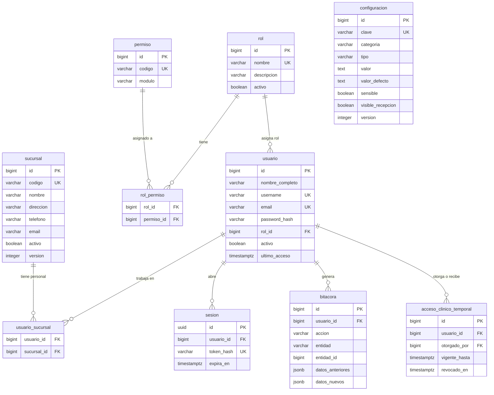
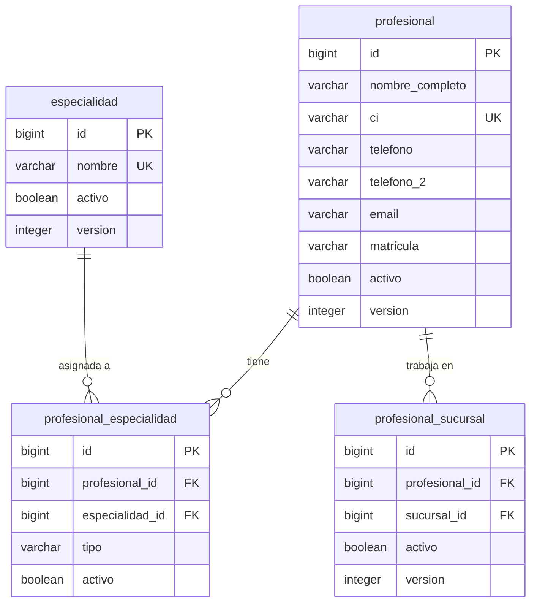
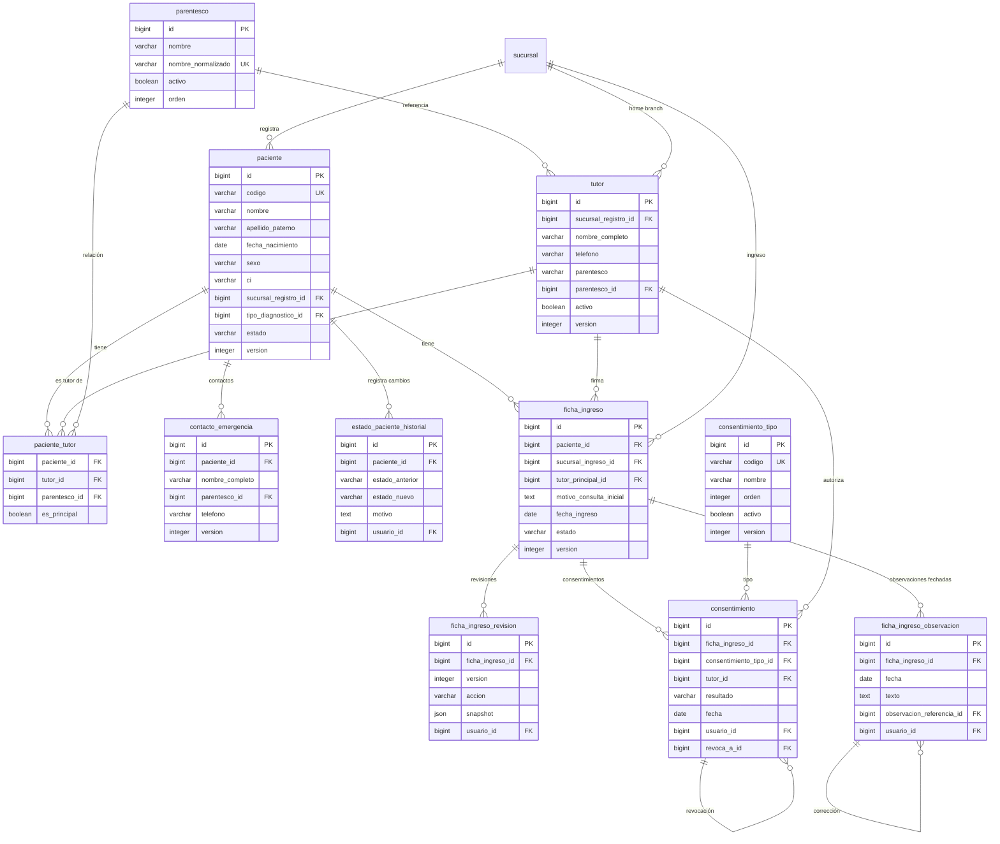
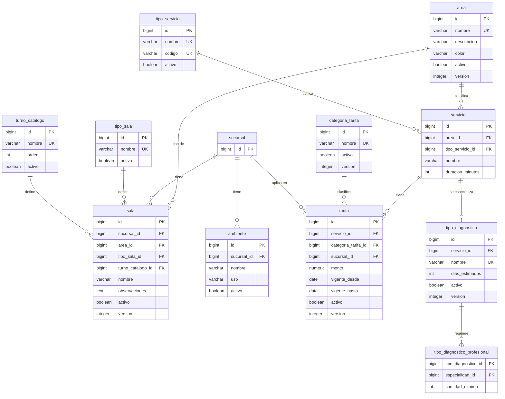
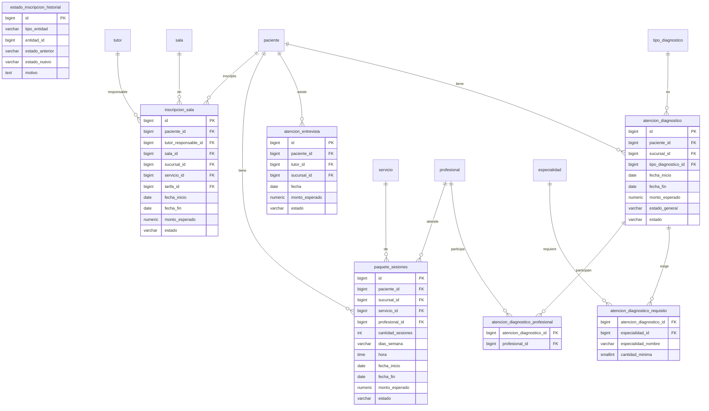
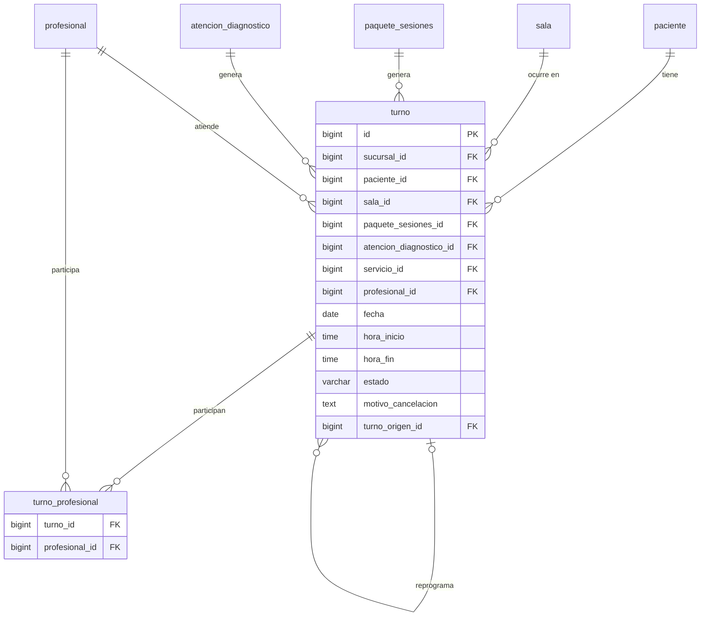
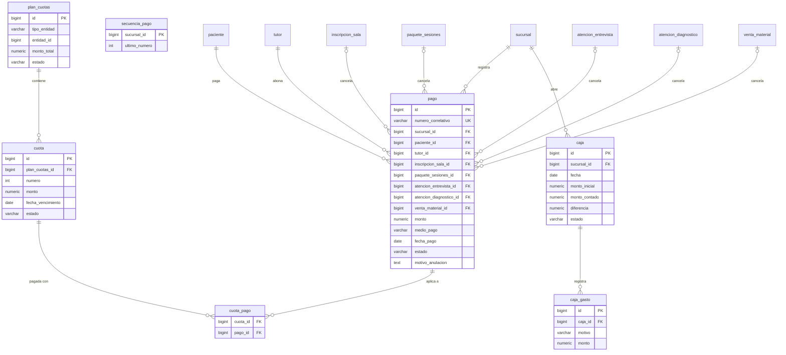
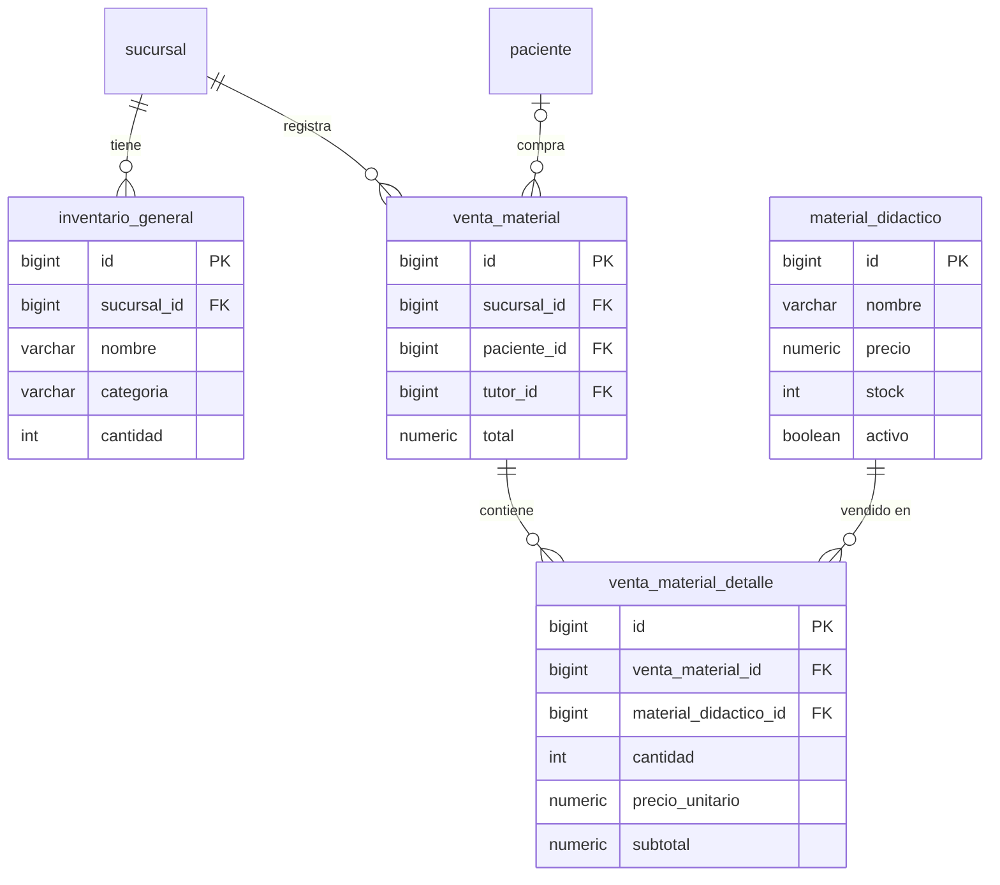
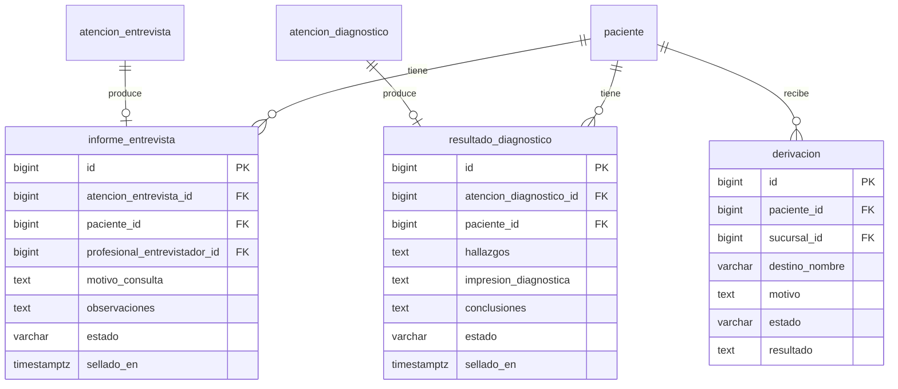
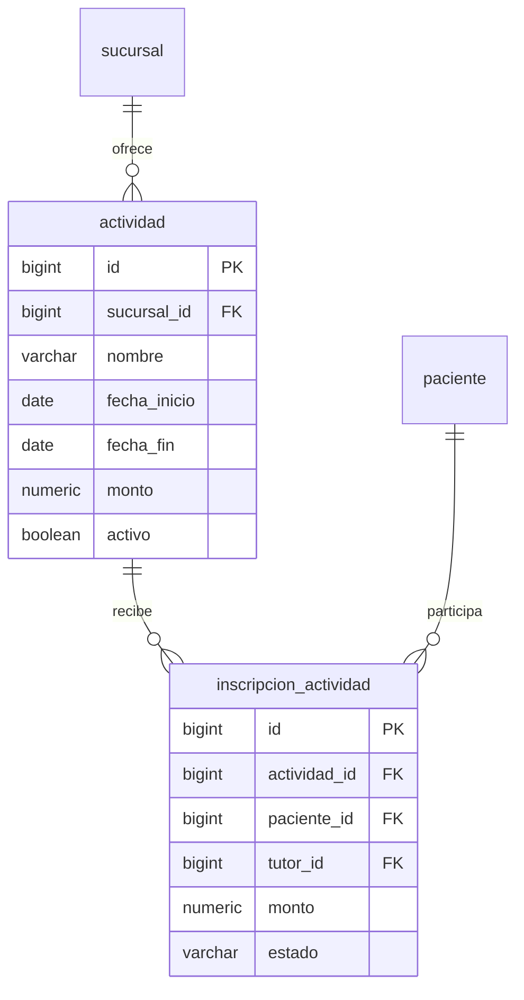

# Base de datos — Sistema de Gestión TalitaCumi

Referencia del esquema PostgreSQL del sistema. Las migraciones deben coincidir con este documento: si cambias una, actualiza el otro en el mismo cambio.

---

## Principios

- **Los documentos no se borran ni se editan.** Pagos, inscripciones, turnos, atenciones, ventas, cajas, cuotas y derivaciones se **anulan** con estado, fecha, usuario y motivo. El inventario se corrige con movimientos inversos.
- **Lo que la BD puede garantizar, lo garantiza** con FKs, CHECKs, índices únicos parciales y triggers. La aplicación valida antes solo para dar mensajes claros.
- **Multisucursal en una sola BD.** Pacientes, tutores, profesionales, servicios, tarifas base y catálogos son globales. Lo transaccional lleva `sucursal_id`.
- **Snapshots.** Cada línea de pago, turno, inscripción y venta copia el monto, el nombre y la tarifa del momento. Cambiar una tarifa no altera documentos pasados.
- **Los cambios de estado quedan en bitácora.** Toda transición de estado de paciente, inscripción, paquete, turno, pago y clínico se registra con usuario, fecha y motivo.
- **El contenido clínico es sensible.** Se cifra en reposo y en tránsito, se accede por rol y sucursal, y cada consulta queda en bitácora.

---

## Convenciones

| Tema | Convención |
|---|---|
| Nombres | Tablas y columnas en español, `snake_case`. La implementación real usa tablas en **singular** (`sucursal`, `sala`, `profesional`); los documentos funcionales pueden usar plural. |
| Claves | `bigint identity` (`GENERATED ALWAYS AS IDENTITY`). |
| Dinero | `numeric(12,2)` en bolivianos. Costos unitarios `numeric(14,4)`. Nunca `float`. |
| Tiempo | `timestamptz` guardado en UTC y mostrado en `America/La_Paz`. `date` para valores sin hora (vencimientos, fechas de inicio y fin). |
| Estados | `varchar` + `CHECK (... IN (...))`, mapeado a enums PHP. No usar el tipo ENUM de Postgres. |
| FKs | Siempre con índice explícito (Postgres no los crea). `ON DELETE RESTRICT` en todo lo transaccional. |
| Borrado | **Sin borrado físico en pacientes ni tutores**: se usa estado (`paciente.estado = retirado`; tutor activo/inactivo en 04.02) y bitácora. `profesional` se activa/desactiva con motivo (03/RN-04, 03/RN-20), sin `deleted_at`. Todo lo transaccional se anula con estado. |
| Nulos | Columnas `NOT NULL` salvo las marcadas como NULL en el diccionario. |
| Búsqueda | Normalización en PHP (sin acentos, minúsculas, espacios colapsados) y columnas normalizadas con índices btree. No se usan `pg_trgm` ni `unaccent`: no están instaladas en la base viva y la suite corre en SQLite. |
| SQL crudo | CHECKs complejos, índices parciales, `UNIQUE NULLS NOT DISTINCT` y triggers van en las migraciones con `DB::statement`. |
| Correlativos | `numero_correlativo` por sucursal y tipo, tomado de `secuencia_pago` con `SELECT … FOR UPDATE` (o `INSERT … ON CONFLICT DO UPDATE`) dentro de la transacción del documento. |
| Auditoría | Trigger `fn_auditar_cambio()` en tablas críticas. Los eventos se registran con `SET LOCAL app.usuario_id`.

Papel de cada tabla: **Maestro** (datos que se editan) · **Configuración** (listas cortas) · **Documento** (se anula, no se borra) · **Detalle** (líneas de un documento) · **Caché derivada** (recalculable) · **Pivot** · **Historial** (solo inserción).

---

## Diagramas por módulo

No se dibujan las relaciones con `sucursal` ni con `usuario` en todas las tablas para no saturar los diagramas: toda tabla con `sucursal_id` pertenece a una sucursal, y `usuario_registro_id`, `usuario_id` y `*_por` apuntan a `usuario`.

### Identidad, sucursales y seguridad



> **Implementación real del módulo 02 (Fase 1):** la base viva usa `users` de Laravel + Spatie (`roles`, `permissions`, `role_has_permissions`, `model_has_roles`) + `personal_access_tokens` de Sanctum. Las entidades `usuario`, `rol`, `permiso`, `rol_permiso` y `sesion` del diagrama son **referencia lógica/aspiracional** y no existen como tablas físicas. La pivote real es `usuario_sucursal`.

### Profesionales

> **Implementación real Fase 1 (módulo 03):** las tablas físicas son `especialidad`, `profesional`, `profesional_especialidad` y `profesional_sucursal`. No hay FK de profesional a `users`: los profesionales no tienen cuenta (03/RN-19). La especialidad principal se guarda únicamente en el pivote `profesional_especialidad` (`tipo = 'principal'`), con un índice único parcial que garantiza una sola principal activa.



### Pacientes y tutores

> **Implementación real 04.01 + 04.02 Fase A:** las tablas físicas son `paciente`, `tutor`, `parentesco`, `paciente_tutor` y `estado_paciente_historial`. `paciente` es global y usa `sucursal_registro_id` como ancla de visibilidad, `version` para concurrencia optimista, columnas normalizadas para búsqueda/unicidad y `tipo_diagnostico_id` con **FK diferida** hasta habilitar la integración con el catálogo 05. No hay `deleted_at`: el retiro es `estado = retirado` (04.01/RF-009, 04.01/RN-006). `tutor` tampoco usa SoftDeletes; se crea activo y se desactiva con motivo. `tutor.sucursal_registro_id` es su home branch y `paciente_tutor.parentesco_id` es el parentesco autoritativo de la relación. `estado_paciente_historial.usuario_id` apunta a `users` en la implementación real.



### Catálogo de servicios, tarifas, salas y ambientes



### Inscripciones y atenciones



### Agenda y turnos



### Pagos, caja y cuotas



### Inventario y ventas (preliminar)



### Evaluaciones y resultados (clínico)



### Actividades extras (preliminar)



---

## Diccionario

### Identidad, sucursales y seguridad

#### `sucursal` — Sucursales

*Configuración.* Las sucursales del centro. Todo lo transaccional lleva `sucursal_id`. Cada usuario accede a una o varias.

| Columna | Tipo | Null | Restricciones | Nota |
|---|---|---|---|---|
| `id` | `bigint` |  | `PK identity` |  |
| `codigo` | `varchar(50)` |  | `UNIQUE` funcional | Único sin distinguir mayúsculas ni espacios externos |
| `nombre` | `varchar(150)` |  | `UNIQUE` funcional | Único sin distinguir mayúsculas ni espacios externos |
| `direccion` | `text` | sí |  |  |
| `telefono` | `varchar(30)` | sí |  |  |
| `email` | `varchar(150)` | sí |  |  |
| `activo` | `boolean` |  | `DEFAULT true` | Estado vigente: activa/inactiva |
| `version` | `integer` |  | `DEFAULT 1` | Concurrencia optimista |

Índices: `UNIQUE ((lower(trim(codigo))))`, `UNIQUE ((lower(trim(nombre))))`. Los espacios internos se normalizan en la aplicación antes de guardar.

Timestamps: `created_at`, `updated_at`.

#### `rol` — Roles (referencia lógica)

> **Implementación real:** la tabla física es `roles` de Spatie (`id`, `name`, `guard_name`, `timestamps`, `version`, `es_superadmin`). `guard_name = 'web'`; `version` habilita concurrencia optimista y `es_superadmin` identifica el rol protegido sin depender del nombre. No hay `activo`.

*Configuración.* Roles base: Superadmin, Administración, Recepción. Los permisos son fijos (definidos por el sistema), pero el rol es editable en su descripción.

| Columna | Tipo | Null | Restricciones | Nota |
|---|---|---|---|---|
| `id` | `bigint` |  | `PK identity` |  |
| `nombre` | `varchar(50)` |  | `UK` |  |
| `descripcion` | `text` | sí |  |  |
| `activo` | `boolean` |  | `DEFAULT true` |  |

Timestamps: `created_at`, `updated_at`.

#### `permiso` — Permisos (referencia lógica)

> **Implementación real:** la tabla física es `permissions` de Spatie (`id`, `name`, `guard_name`, `timestamps`). El módulo (`usuario`, `rol`, `bitacora`, etc.) se deriva del prefijo `entidad.accion`.

*Configuración.* Permisos granulares por módulo y acción, definidos por el sistema. `codigo` es único (`paciente.ver`, `pago.anular`, `clinico.exportar`…).

| Columna | Tipo | Null | Restricciones | Nota |
|---|---|---|---|---|
| `id` | `bigint` |  | `PK identity` |  |
| `codigo` | `varchar(100)` |  | `UK` |  |
| `descripcion` | `text` | sí |  |  |
| `modulo` | `varchar(50)` |  |  |  |

Timestamps: solo `created_at`.

#### `rol_permiso` — Permisos por rol (referencia lógica)

> **Implementación real:** la tabla física es `role_has_permissions` de Spatie (`permission_id`, `role_id`).

*Pivot.*

| Columna | Tipo | Null | Restricciones | Nota |
|---|---|---|---|---|
| `rol_id` | `bigint` |  | `FK → rol` |  |
| `permiso_id` | `bigint` |  | `FK → permiso` |  |

`PRIMARY KEY (rol_id, permiso_id)`. Sin timestamps.

#### `users` — Usuarios (implementación real)

*Maestro.* Solo Superadmin, Administración y Recepción usan el sistema. Los profesionales y los padres no. El nombre lógico `usuario` se mantiene en la documentación funcional; la tabla física es `users`.

| Columna | Tipo | Null | Restricciones | Nota |
|---|---|---|---|---|
| `id` | `bigint` |  | `PK identity` |  |
| `name` | `varchar(255)` |  |  | Nombre completo |
| `username` | `varchar(100)` | sí | `UNIQUE` | Login principal; obligatorio en la aplicación |
| `documento` | `varchar(20)` | sí | `UNIQUE` | CI; obligatorio en la aplicación |
| `email` | `varchar(255)` | sí | `UNIQUE` | Opcional. Login alternativo si está presente; no se usa para envíos |
| `email_verified_at` | `timestamp` | sí |  | No se usa en Etapa 1 |
| `password` | `varchar(255)` |  |  | Hash bcrypt |
| `activo` | `boolean` |  | `DEFAULT true` | RN-05/RN-06 |
| `motivo_estado` | `text` | sí |  | Motivo de la última desactivación |
| `estado_cambiado_en` | `timestamptz` | sí |  |  |
| `ultimo_acceso` | `timestamptz` | sí |  | RF-A16 |
| `intentos_fallidos` | `smallint` |  | `DEFAULT 0` |  |
| `bloqueado_hasta` | `timestamptz` | sí |  | Bloqueo temporal |
| `debe_cambiar_password` | `boolean` |  | `DEFAULT false` | RF-A13 |
| `password_actualizada_en` | `timestamptz` | sí |  | Caducidad opcional |
| `version` | `integer` |  | `DEFAULT 1` | Concurrencia optimista |
| `remember_token` | `varchar(100)` | sí |  | Laravel |
| `created_at` / `updated_at` | `timestamptz` | sí |  |  |

Índices: `UNIQUE (username)`, `UNIQUE (documento)`, `UNIQUE (email)` (permite múltiples `NULL`), `INDEX (activo)`. El rol vive en `model_has_roles` (Spatie) y no en una columna `rol_id`. No hay `deleted_at`. Login: `username` o `email` si existe.

#### `usuario_sucursal` — Usuario en sucursal

*Pivot.* En qué sucursales puede trabajar cada usuario. **No hay concepto de “sucursal activa en sesión”**: el alcance se evalúa contra todas las sucursales asignadas. La implementación real (`EloquentUserBranchAccess`) está activa desde la Fase 2. El Superadmin con `sucursal.alcance_global` puede operar sin pivotes; el bootstrap lo crea sin sucursales si aún no hay ninguna.

| Columna | Tipo | Null | Restricciones | Nota |
|---|---|---|---|---|
| `usuario_id` | `bigint` |  | `FK → users`, `ON DELETE CASCADE` |  |
| `sucursal_id` | `bigint` |  | `FK → sucursal`, `ON DELETE CASCADE` |  |

`PRIMARY KEY (usuario_id, sucursal_id)`, `INDEX (sucursal_id)`. Sin timestamps.

#### `usuario_password_historial` — Historial de contraseñas

*Historial.* Solo hashes de contraseñas anteriores. No guarda contraseñas en claro.

| Columna | Tipo | Null | Restricciones | Nota |
|---|---|---|---|---|
| `id` | `bigint` |  | `PK identity` |  |
| `usuario_id` | `bigint` |  | `FK → users`, `ON DELETE CASCADE` |  |
| `password_hash` | `varchar(255)` |  |  | Hash bcrypt |
| `created_at` | `timestamptz` |  | `DEFAULT now()` |  |

Índice: `(usuario_id, created_at)`. Sin `updated_at`. Se podan los hashes más antiguos según `password_historial_cantidad`.

#### `modulo_permisos_inicializado` — Matriz inicial por módulo

*Configuración interna.* Marca qué módulos ya aplicaron su matriz inicial para que `db:seed` no vuelva a conceder permisos revocados por UI (RF-R04).

| Columna | Tipo | Null | Restricciones | Nota |
|---|---|---|---|---|
| `modulo` | `varchar(100)` |  | `PK` | Ej. `seguridad`, `organizacion.sucursales`, `seguridad.matriz_baseline` |
| `inicializado_en` | `timestamptz` |  | `DEFAULT now()` |  |

La clave `seguridad.matriz_baseline` marca la línea base histórica de la matriz (Fase 3); evita duplicar el evento inicial en cada `db:seed`.

#### `sesion` — Sesiones (referencia lógica, no implementada)

> **No implementada:** el módulo 02 usa `personal_access_tokens` de Sanctum. No se crea la tabla `sesion`. La expiración absoluta se guarda en `personal_access_tokens.expires_at`; la inactividad se mide con `last_used_at` y `sesion_inactividad_minutos`.

*Documento.* Sesiones activas. Token con hash. Cierre por inactividad en contenido clínico.

| Columna | Tipo | Null | Restricciones | Nota |
|---|---|---|---|---|
| `id` | `uuid` |  | `PK` |  |
| `usuario_id` | `bigint` |  | `FK → usuario` |  |
| `token_hash` | `varchar(255)` |  | `UK` |  |
| `ip` | `varchar(45)` | sí |  |  |
| `user_agent` | `text` | sí |  |  |
| `creada_en` | `timestamptz` |  | `DEFAULT now()` |  |
| `expira_en` | `timestamptz` |  |  |  |
| `cerrada_en` | `timestamptz` | sí |  |  |

Índices: `INDEX (usuario_id)`, `INDEX (expira_en)`.

#### `personal_access_tokens` — Tokens de sesión (Sanctum)

*Documento.* Tabla real de sesiones de API. Cada fila es un token bearer; el valor en claro nunca se guarda, solo su hash.

| Columna | Tipo | Null | Restricciones | Nota |
|---|---|---|---|---|
| `id` | `bigint` |  | `PK identity` |  |
| `tokenable_type` / `tokenable_id` | `varchar` / `bigint` |  | índice | Apunta a `App\Models\User` |
| `name` | `text` |  |  | `sesion` |
| `token` | `varchar(64)` |  | `UNIQUE` | Hash del token |
| `abilities` | `text` | sí |  |  |
| `last_used_at` | `timestamp` | sí |  | Actualizado por `EnsureSessionIsValid` |
| `expires_at` | `timestamp` | sí | índice | Expiración absoluta |
| `created_at` / `updated_at` | `timestamp` | sí |  |  |

No se crea la tabla `sesion`. El límite de sesiones y la revocación se implementan sobre esta tabla.

#### `bitacora` — Bitácora

*Historial.* Solo inserción. Registra quién hizo qué, cuándo y en qué sucursal. Inmutable.

| Columna | Tipo | Null | Restricciones | Nota |
|---|---|---|---|---|
| `id` | `bigint` |  | `PK identity` |  |
| `usuario_id` | `bigint` | sí | `FK → users` | NULL en intentos fallidos con usuario desconocido |
| `sucursal_id` | `bigint` | sí | `FK → sucursal` | En eventos de usuario se replica una fila por sucursal activa del usuario afectado; los usuarios con alcance global y los eventos globales quedan NULL |
| `accion` | `varchar(100)` |  |  | `CREAR`, `EDITAR`, `ACTIVAR`, `DESACTIVAR`, `LOGIN`, `LOGIN_FALLIDO`, `CERRAR_SESION`, `BLOQUEAR`, etc. |
| `entidad` | `varchar(100)` | sí |  | `usuario`, `sesion`, `sucursal`, `parametro`, etc. |
| `entidad_id` | `bigint` | sí |  |  |
| `datos_anteriores` | `jsonb` | sí |  |  |
| `datos_nuevos` | `jsonb` | sí |  |  |
| `motivo` | `text` | sí |  | Para anulaciones, bloqueos y desactivaciones |
| `ip` | `varchar(45)` | sí |  | Se completa en el módulo 02; filas de 01/02/03 lo dejan NULL |
| `modulo` | `varchar(50)` | sí |  | `autenticacion`, `usuarios`, `roles`, `auditoria`; NULL en filas históricas |
| `resultado` | `varchar(20)` | sí |  | `exito`, `fallo`, `denegado`; NULL en filas históricas |
| `critico` | `boolean` |  | `DEFAULT false` | Eventos críticos (bloqueo, matriz, exportación) |
| `created_at` | `timestamptz` |  | `DEFAULT now()` |  |

Índices: `(usuario_id)`, `(created_at)`, `(entidad, entidad_id)`, `(accion)`, `(modulo)`, `(resultado)`, `(critico)`, `(sucursal_id, created_at)`. Trigger `BEFORE UPDATE OR DELETE` que lanza error. Sin `updated_at`.

> **Implementación real:** la tabla física de usuarios es `users`; `bitacora.usuario_id` sigue apuntando a `users.id` y no se migra a una tabla `usuario` inexistente. Las columnas `modulo`, `resultado` y `critico` son nullable/default para tolerar filas históricas, porque el trigger impide rellenarlas con UPDATE. Los listeners de 01/03 no se modificaron en la Fase 1. En la Fase 3, la matriz usa `entidad = 'matriz_permisos'`, `accion = 'EDITAR_PERMISOS'`, con antes/después y `linea_base = true` en el evento inicial. En la Fase 4, las consultas a la bitácora usan `entidad = 'bitacora'`, `accion = 'CONSULTAR'`, y las exportaciones `entidad = 'exportacion'`, `accion = 'EXPORTAR'`, `critico = true`. Los eventos de seguridad de usuario se escriben con `sucursal_id` de cada sucursal activa del usuario afectado (una fila por sucursal); los usuarios con alcance global se registran una sola vez con `sucursal_id NULL`. La matriz, las consultas a la bitácora y las exportaciones siguen siendo globales (`sucursal_id NULL`) y solo las ve el Superadmin. En el módulo 03, los eventos de `profesional` y `profesional_especialidad` se replican por sucursal activa del profesional; `especialidad` y los profesionales sin sucursal quedan con `sucursal_id NULL`.

#### `acceso_clinico_temporal` — Acceso especial a contenido clínico

*Documento.* Acceso temporal otorgado por Superadmin a un usuario específico, con motivo y vencimiento. Revocable.

| Columna | Tipo | Null | Restricciones | Nota |
|---|---|---|---|---|
| `id` | `bigint` |  | `PK identity` |  |
| `usuario_id` | `bigint` |  | `FK → usuario` |  |
| `otorgado_por` | `bigint` |  | `FK → usuario` |  |
| `recurso` | `varchar(100)` |  |  |  |
| `motivo` | `text` |  |  | Obligatorio |
| `vigente_desde` | `timestamptz` |  | `DEFAULT now()` |  |
| `vigente_hasta` | `timestamptz` |  |  |  |
| `revocado_en` | `timestamptz` | sí |  |  |

Índices: `(usuario_id)`, `(vigente_hasta)`.

#### `configuracion` — Parámetros del sistema

*Configuración.* Valores configurables sin tocar código. Catálogo versionado por seeder/migración; no se crean ni eliminan desde la UI y no tiene borrado lógico.

| Columna | Tipo | Null | Restricciones | Nota |
|---|---|---|---|---|
| `id` | `bigint` |  | `PK identity` |  |
| `clave` | `varchar(100)` |  | `UK` | Clave estable del catálogo (`duracion_sesion_minutos`, `agenda.turno_manana.inicio`, `moneda`…) |
| `categoria` | `varchar(50)` |  | índice | `identidad`, `operacion`, `agenda`, `pagos`, `formato_documentos`, `zona_horaria`, `moneda` |
| `descripcion` | `text` | sí |  | Texto en español para la UI |
| `tipo` | `varchar(20)` |  | `DEFAULT 'texto'`, CHECK | `entero`, `decimal`, `hora`, `texto`, `booleano` |
| `valor` | `text` |  |  | Valor vigente serializado como texto |
| `valor_defecto` | `text` |  |  | Se usa para restaurar (RF-005) |
| `unidad` | `varchar(30)` | sí |  | `minutos`, `horas`, `días`, `Bs`… |
| `minimo` | `text` | sí |  | Límite inferior; en textos representa longitud |
| `maximo` | `text` | sí |  | Límite superior; en textos representa longitud |
| `sensible` | `boolean` |  | `DEFAULT false` | Exige confirmación y motivo (RF-016) |
| `editable` | `boolean` |  | `DEFAULT true` | `false` para moneda, leyenda y logo (carga especial) |
| `visible_recepcion` | `boolean` |  | `DEFAULT false` | Filtra lo que ve Recepción (RF-014) |
| `version` | `integer` |  | `DEFAULT 1` | Concurrencia optimista (409) |

Timestamps: solo `updated_at`. Las altas y cambios se reconstruyen desde `bitacora` (`entidad = 'parametro'`). No hay `sucursal_id`: los parámetros son globales (RN-009).

Índices: `clave` único, `categoria`, `visible_recepcion`. El catálogo inicial tiene 23 claves y se carga con `OrganizacionConfiguracionCatalogSeeder`; cada alta deja un registro `CREAR` en bitácora.

> **Módulo 02 (Fases 1–4):** se agregaron 12 claves de seguridad (categoría `seguridad`), por lo que el catálogo pasa a 35 claves. `sesion_inactividad_minutos` se reutiliza en `operacion`. Las fases 2 y 3 no agregan tablas; la Fase 4 agrega `accion_auditada` y reutiliza `bitacora`.
>
> **Módulo 06.04 (Vigencias):** se agrega `vigencia.ventana_alerta_dias` (categoría `operacion`, entero, valor inicial 7, rango 1–365). Es un parámetro global; no se agregan columnas ni tablas de vigencia.

#### `accion_auditada` — Catálogo de acciones auditadas

*Configuración.* Catálogo mínimo de acciones auditables por módulo, entidad y acción (02/RF-B03). No es la bitácora: solo describe qué acciones existen y si son críticas.

| Columna | Tipo | Null | Restricciones | Nota |
|---|---|---|---|---|
| `id` | `bigint` |  | `PK identity` |  |
| `modulo` | `varchar(50)` |  |  | `organizacion`, `usuarios`, `autenticacion`, `roles`, `auditoria`, `profesionales` |
| `entidad` | `varchar(100)` |  |  | `usuario`, `sesion`, `matriz_permisos`, `bitacora`, `exportacion`, `profesional`, `especialidad`, `profesional_especialidad`, `profesional_sucursal`, etc. |
| `accion` | `varchar(100)` |  |  | `CREAR`, `EDITAR`, `DESACTIVAR`, `CONSULTAR`, `EXPORTAR`, etc. |
| `critico` | `boolean` |  | `DEFAULT false` | Marca para filtro rápido (RF-B13) |
| `activo` | `boolean` |  | `DEFAULT true` |  |
| `descripcion` | `text` | sí |  | Etiqueta legible para la UI |

`UNIQUE (modulo, entidad, accion)`, `INDEX (modulo, activo)`. Timestamps. Seeder idempotente `AccionAuditadaSeeder` (40 acciones, 7 críticas al cierre de la Fase 4) y `ProfesionalesAccionAuditadaSeeder` para el módulo 03.

#### Migraciones del módulo 02 — Fases 1–4

- `2026_11_21_000000_add_security_fields_to_users_table.php`
- `2026_11_21_000100_create_usuario_sucursal_table.php`
- `2026_11_21_000200_create_usuario_password_historial_table.php`
- `2026_11_21_000300_add_audit_fields_to_bitacora_table.php`
- `2026_11_21_000400_add_matrix_fields_to_roles_table.php`
- `2026_11_21_000500_create_modulo_permisos_inicializado_table.php`
- `2026_11_21_000600_create_accion_auditada_table.php`
- `2026_11_21_000700_make_users_email_nullable.php`

La Fase 2 no requirió migraciones nuevas. La Fase 3 tampoco: usa `roles.version`, `roles.es_superadmin` y `bitacora`. La Fase 4 agrega `accion_auditada`; la bitácora sigue en `bitacora`. La migración `000700` hace opcional `users.email`; el login por usuario ya existía y el correo deja de ser obligatorio en el alta.

---

### Profesionales

#### `especialidad` — Especialidades

*Configuración.* Catálogo global de especialidades. El nombre es único sin distinguir mayúsculas ni espacios externos.

| Columna | Tipo | Null | Restricciones | Nota |
|---|---|---|---|---|
| `id` | `bigint` |  | `PK identity` |  |
| `nombre` | `varchar(100)` |  | `NOT NULL`; unique funcional `lower(trim(nombre))` |  |
| `descripcion` | `text` | sí |  |  |
| `activo` | `boolean` |  | `DEFAULT true` | Estado lógico; no hay SoftDeletes |
| `version` | `integer` |  | `DEFAULT 1` | Concurrencia optimista |
| `motivo_estado` | `text` | sí |  | Motivo del último cambio de estado |
| `estado_cambiado_en` | `timestamptz` | sí |  |  |

Timestamps: `created_at`, `updated_at`.

#### `profesional` — Profesionales

*Maestro.* Los profesionales NO usan el sistema; son un directorio administrativo. No hay FK a `users`, ni cuenta, ni rol Spatie (03/RN-19).

| Columna | Tipo | Null | Restricciones | Nota |
|---|---|---|---|---|
| `id` | `bigint` |  | `PK identity` |  |
| `nombre_completo` | `varchar(200)` |  | `NOT NULL` |  |
| `ci` | `varchar(30)` |  | `NOT NULL`; unique funcional `lower(trim(ci))` | Documento de identidad (03/RN-01) |
| `telefono` | `varchar(30)` | sí |  |  |
| `telefono_2` | `varchar(30)` | sí |  |  |
| `email` | `varchar(150)` | sí |  |  |
| `matricula` | `varchar(50)` | sí |  | Supuesto a validar; opcional |
| `activo` | `boolean` |  | `DEFAULT true` | Estado lógico; no hay SoftDeletes |
| `version` | `integer` |  | `DEFAULT 1` | Concurrencia optimista |
| `motivo_estado` | `text` | sí |  | Motivo del último cambio de estado |
| `estado_cambiado_en` | `timestamptz` | sí |  |  |

Timestamps: `created_at`, `updated_at`. Sin `deleted_at`.

#### `profesional_especialidad` — Especialidades del profesional

*Pivot con historial.* Única fuente de verdad de la especialidad principal (03/RN-02).

| Columna | Tipo | Null | Restricciones | Nota |
|---|---|---|---|---|
| `id` | `bigint` |  | `PK identity` |  |
| `profesional_id` | `bigint` |  | `FK → profesional` `RESTRICT` |  |
| `especialidad_id` | `bigint` |  | `FK → especialidad` `RESTRICT` |  |
| `tipo` | `varchar` |  | `CHECK IN ('principal','secundaria')` |  |
| `activo` | `boolean` |  | `DEFAULT true` | Conserva historial sin borrado físico |

Índices únicos parciales:

- `(profesional_id, especialidad_id) WHERE activo` → no duplicar la relación activa (03/RF-E07).
- `(profesional_id) WHERE tipo = 'principal' AND activo` → exactamente una principal activa (03/RN-02).

Timestamps: `created_at`, `updated_at`.

#### `profesional_sucursal` — Sucursales del profesional

*Pivot con historial.* La relación es independiente de la especialidad (03/RN-10).

| Columna | Tipo | Null | Restricciones | Nota |
|---|---|---|---|---|
| `id` | `bigint` |  | `PK identity` |  |
| `profesional_id` | `bigint` |  | `FK → profesional` `RESTRICT` |  |
| `sucursal_id` | `bigint` |  | `FK → sucursal` `RESTRICT` |  |
| `activo` | `boolean` |  | `DEFAULT true` |  |
| `motivo` | `text` | sí |  | Obligatorio al activar/desactivar (03/RN-20) |
| `version` | `integer` |  | `DEFAULT 1` | Concurrencia optimista |

Índice único parcial `(profesional_id, sucursal_id) WHERE activo` → no duplicar la relación activa (03/RF-E07).

Timestamps: `created_at`, `updated_at`.

**Migraciones del módulo 03 (Fase 1):**

- `2026_11_22_000000_create_especialidad_table.php`
- `2026_11_22_000100_create_profesional_table.php`
- `2026_11_22_000200_create_profesional_especialidad_table.php`
- `2026_11_22_000300_create_profesional_sucursal_table.php`

**Seeders:** `ProfesionalesPermissionSeeder`, `EspecialidadCatalogoSeeder` (5 especialidades base, PROPUESTO - VALIDAR), `ProfesionalesAccionAuditadaSeeder`.

---

### Implementación real módulo 04 — Pacientes y tutores

**Migraciones del módulo 04 (04.01 Fase 1 + 04.02 Fase A):**

- `2026_11_23_000000_create_tutor_table.php`
- `2026_11_23_000100_create_paciente_table.php`
- `2026_11_23_000200_create_paciente_tutor_table.php`
- `2026_11_23_000300_create_estado_paciente_historial_table.php`
- `2026_11_24_000000_create_parentesco_table.php`
- `2026_11_24_000100_add_tutor_fields_table.php`
- `2026_11_24_000200_add_parentesco_to_paciente_tutor_table.php`
- `2026_11_24_000300_create_contacto_emergencia_table.php`
- `2026_11_24_000400_create_ficha_ingreso_tables.php`
- `2026_11_24_000500_create_consentimiento_tables.php`
- `2026_11_24_000600_create_ficha_ingreso_observacion_table.php`

**Seeders:** `PacientesPermissionSeeder` (matriz inicial `pacientes`), `PacientesAccionAuditadaSeeder` (5 acciones de paciente), `ParentescoCatalogoSeeder` (catálogo inicial propuesto), `TutoresPermissionSeeder` (matriz inicial `pacientes.tutores`), `TutoresAccionAuditadaSeeder` (7 acciones de tutor y asociación), `ContactosEmergenciaPermissionSeeder` (matriz inicial `pacientes.contactos_emergencia`), `ContactosEmergenciaAccionAuditadaSeeder` (3 acciones de contacto), `FichaIngresoPermissionSeeder` (matriz inicial `pacientes.ficha_ingreso`), `FichaIngresoAccionAuditadaSeeder` (7 acciones de ficha), `ConsentimientoPermissionSeeder` (matriz inicial `pacientes.ficha_ingreso_consentimiento`), `ConsentimientoTipoSeeder` (3 tipos propuestos), `ConsentimientoAccionAuditadaSeeder` (6 acciones de consentimiento), `ObservacionPermissionSeeder` (matriz `pacientes.ficha_ingreso_observacion`) y `ObservacionAccionAuditadaSeeder` (1 acción de observación).

**Decisiones de esquema:**

- `tipo_diagnostico_id` queda nullable y **sin FK física**. La tabla `tipo_diagnostico` ya existe desde 05.03, pero la constraint se agregará cuando se habilite la integración con 04. La Action rechaza valores no nulos mientras `PacientesModule::DIAGNOSTICOS_DISPONIBLES = false`.
- `sucursal_registro_id` es `NOT NULL` y se valida contra el alcance del usuario. No cambia desde la edición.
- `sexo` es obligatorio (`M`/`F`).
- `codigo` se genera como `PAC-` + id con 6 dígitos.
- No se aplica el trigger genérico `tg_paciente_audit` del .sql: la bitácora la escribe `RecordPacientesAudit`, que no copia contenido clínico.
- `paciente`, `tutor` y `paciente_tutor` no usan `deleted_at`.
- `parentesco` es un catálogo configurable; los valores iniciales del seeder son una propuesta a validar con el cliente.
- `tutor.sucursal_registro_id` (home branch) es nullable por compatibilidad, pero la aplicación lo exige al crear según el alcance del usuario. La migración hace backfill con el primer paciente asociado o la última fila `CREAR` de bitácora.
- `paciente_tutor.parentesco_id` es el parentesco autoritativo por relación; `tutor.parentesco_id` solo es el valor de referencia.
- La migración de `parentesco` en SQLite recrea el índice parcial `paciente_tutor_principal_uk` después del `ALTER TABLE`, porque la reconstrucción de tabla lo pierde.
- `contacto_emergencia` pertenece al paciente, no al tutor. Se elimina físicamente; la bitácora conserva el snapshot con el teléfono completo. `version` habilita concurrencia optimista.
- `ficha_ingreso` es administrativa y de contexto; no es la entrevista del módulo 06 ni el registro clínico del módulo 11. Una sola ficha no archivada por paciente mediante índice parcial; las anteriores quedan archivadas y consultables.
- `ficha_ingreso_revision` guarda el snapshot completo e inmutable. La bitácora solo conserva metadatos, banderas `tiene_*` y campos modificados; nunca contenido sensible.
- `tutor_principal_id` es nullable para permitir ficha sin tutor. Los consentimientos exigen al menos un tutor activo asociado.
- `consentimiento_tipo` es un catálogo configurable (no enum) y no se elimina: se activa o desactiva. Los tipos iniciales son una propuesta a validar con el cliente.
- `consentimiento` es un evento inmutable: no se edita ni se borra. La revocación es una fila nueva con `resultado='revocado'` y `revoca_a_id` apuntando al consentimiento original. El motivo libre no se copia a la bitácora.
- La vigencia se calcula como un `otorgado` sin una revocación posterior. No hay vencimiento automático; queda pendiente de definición del cliente.
- `ficha_ingreso_observacion` es solo inserción: no se edita ni se borra. Una corrección es una observación nueva con `observacion_referencia_id` apuntando a la anterior (RN-003). El texto es sensible y no se copia a la bitácora.
- `04.04` (búsqueda y ficha resumen) no agrega tablas, columnas ni índices. Reutiliza `paciente` (columnas normalizadas), `tutor` (nombre y teléfono normalizados), `paciente_tutor` (unique parcial del principal), `bitacora` y `accion_auditada`. La exportación CSV no persiste datos.

---

### Pacientes y tutores

#### `paciente` — Pacientes (niños)

*Maestro.* Paciente global (no por sucursal). Estado: activo, en pausa, retirado. `sucursal_registro_id` es el ancla de visibilidad, no una duplicación por sucursal.

| Columna | Tipo | Null | Restricciones | Nota |
|---|---|---|---|---|
| `id` | `bigint` |  | `PK identity` |  |
| `codigo` | `varchar(30)` | sí | `UK` | Autogenerado `PAC-000001` |
| `nombre` | `varchar(100)` |  |  |  |
| `apellido_paterno` | `varchar(100)` |  |  |  |
| `apellido_materno` | `varchar(100)` | sí |  |  |
| `fecha_nacimiento` | `date` |  |  | No futura; sin rango máximo/mínimo |
| `sexo` | `varchar(1)` |  | `CHECK IN ('M','F')` | Obligatorio |
| `ci` | `varchar(20)` | sí |  | Documento opcional; único normalizado |
| `tipo_diagnostico_id` | `bigint` | sí | `FK diferida → tipo_diagnostico` | Catálogo del módulo 05 |
| `sucursal_registro_id` | `bigint` |  | `FK → sucursal` | Visibilidad inicial |
| `estado` | `varchar(20)` |  | `DEFAULT 'activo'`, `CHECK IN ('activo','en_pausa','retirado')` |  |
| `alergias` | `text` | sí |  | Sensible |
| `condiciones_medicas` | `text` | sí |  | Sensible |
| `observaciones` | `text` | sí |  | No se copia a bitácora |
| `nombre_normalizado` | `varchar(100)` |  |  | Sin acentos, minúsculas |
| `apellido_paterno_normalizado` | `varchar(100)` |  |  |  |
| `apellido_materno_normalizado` | `varchar(100)` | sí |  |  |
| `nombre_completo_normalizado` | `varchar(320)` |  |  | Búsqueda/orden |
| `documento_normalizado` | `varchar(30)` | sí | `UK` | Múltiples NULL permitidos |
| `version` | `integer` |  | `DEFAULT 1` | Concurrencia optimista |

Índices: `(estado)`, `(fecha_nacimiento)`, `(sucursal_registro_id)`, `(tipo_diagnostico_id)`, `(nombre_normalizado)`, `(apellido_paterno_normalizado)`, `(apellido_materno_normalizado)`, `(nombre_completo_normalizado)`, `(documento_normalizado)`, `(updated_at)`. Timestamps: `created_at`, `updated_at`. **Sin `deleted_at`**: el retiro es `estado = retirado`.

#### `tutor` — Tutores

*Maestro.* Tutor global. Teléfono obligatorio para alertas de WhatsApp. Se crea activo y se desactiva con motivo; no se elimina.

| Columna | Tipo | Null | Restricciones | Nota |
|---|---|---|---|---|
| `id` | `bigint` |  | `PK identity` |  |
| `sucursal_registro_id` | `bigint` | sí | `FK → sucursal`, `RESTRICT` | Home branch; obligatoria al crear según alcance |
| `nombre_completo` | `varchar(200)` |  |  |  |
| `ci` | `varchar(20)` | sí |  | Único normalizado |
| `telefono` | `varchar(30)` |  |  | 8 dígitos normalizados; móvil 6/7 |
| `telefono_alternativo` | `varchar(30)` | sí |  | 8 dígitos; 2/3/4/6/7 |
| `email` | `varchar(150)` | sí |  |  |
| `direccion` | `text` | sí |  |  |
| `parentesco` | `varchar(50)` | sí |  | Texto legacy; se resuelve al catálogo |
| `parentesco_id` | `bigint` | sí | `FK → parentesco`, `RESTRICT` | Parentesco de referencia |
| `activo` | `boolean` |  | `DEFAULT true` | Desactivar exige motivo |
| `version` | `integer` |  | `DEFAULT 1` | Concurrencia optimista |
| `motivo_estado` | `text` | sí |  | Motivo de desactivación |
| `estado_cambiado_en` | `timestamptz` | sí |  |  |
| `nombre_completo_normalizado` | `varchar(200)` |  |  |  |
| `documento_normalizado` | `varchar(20)` | sí | `UK` |  |
| `telefono_normalizado` | `varchar(30)` |  |  | Solo dígitos |

Índices: `(activo)`, `(sucursal_registro_id)`, `(parentesco_id)`, `(nombre_completo_normalizado)`, `(telefono_normalizado)`, `(documento_normalizado)` y único `(nombre_completo_normalizado, telefono_normalizado)`. Timestamps: `created_at`, `updated_at`. **Sin `deleted_at`**.

#### `parentesco` — Catálogo de parentescos

*Catálogo.* Valores configurables; el seeder inicial es una propuesta a validar.

| Columna | Tipo | Null | Restricciones | Nota |
|---|---|---|---|---|
| `id` | `bigint` |  | `PK identity` |  |
| `nombre` | `varchar(50)` |  |  |  |
| `nombre_normalizado` | `varchar(50)` |  | `UK` | Sin acentos, minúsculas |
| `activo` | `boolean` |  | `DEFAULT true` |  |
| `orden` | `integer` |  | `DEFAULT 0` | Orden de presentación |

#### `paciente_tutor` — Paciente y tutores

*Pivot.* Un paciente puede tener varios tutores. Exactamente uno debe ser principal; índice único parcial `(paciente_id) WHERE es_principal`.

`PRIMARY KEY (paciente_id, tutor_id)`. `parentesco_id bigint FK → parentesco` (autoritativo por relación). `es_principal boolean DEFAULT false`. Sin timestamps.

#### `contacto_emergencia` — Contactos de emergencia del paciente

*Detalle.* Persona adicional al tutor a la que contactar en una emergencia (04.02/RF-012). No es global ni tiene relación con otros pacientes.

| Columna | Tipo | Null | Restricciones | Nota |
|---|---|---|---|---|
| `id` | `bigint` |  | `PK identity` |  |
| `paciente_id` | `bigint` |  | `FK → paciente`, `CASCADE` |  |
| `nombre_completo` | `varchar(200)` |  |  |  |
| `nombre_normalizado` | `varchar(200)` |  |  | Sin acentos, minúsculas |
| `parentesco_id` | `bigint` |  | `FK → parentesco`, `RESTRICT` | Catálogo activo |
| `telefono` | `varchar(30)` |  |  | 8 dígitos normalizados; fijo 2/3/4 o móvil 6/7 |
| `telefono_normalizado` | `varchar(30)` |  |  | Solo dígitos, sin 591/0 inicial |
| `version` | `integer` |  | `DEFAULT 1` | Concurrencia optimista |
| `created_at` | `timestamptz` |  |  |  |
| `updated_at` | `timestamptz` |  |  |  |

Índices: `(paciente_id)`, `(parentesco_id)`, `(paciente_id, nombre_normalizado)`, `(telefono_normalizado)`. **Sin `deleted_at`**: se elimina físicamente y la bitácora conserva el snapshot.

#### `estado_paciente_historial` — Historial del estado del paciente

*Historial.* Solo inserción. Registra las transiciones de estado con motivo.

| Columna | Tipo | Null | Restricciones | Nota |
|---|---|---|---|---|
| `id` | `bigint` |  | `PK identity` |  |
| `paciente_id` | `bigint` |  | `FK → paciente` |  |
| `estado_anterior` | `varchar(20)` | sí | `CHECK IN ('activo','en_pausa','retirado')` | NULL en el alta |
| `estado_nuevo` | `varchar(20)` |  | `CHECK IN ('activo','en_pausa','retirado')` |  |
| `motivo` | `text` | sí |  | Obligatorio en retiro, retorno de retiro y pausa (supuesto validado con 06.05) |
| `usuario_id` | `bigint` |  | `FK → users` | Implementación real |
| `created_at` | `timestamptz` |  | `DEFAULT now()` |  |

Sin `updated_at`. Índice `(paciente_id, created_at)`.

#### `ficha_ingreso` — Ficha de ingreso

*Documento.* Datos administrativos y de contexto del ingreso (no clínicos). Una sola ficha no archivada por paciente.

| Columna | Tipo | Null | Restricciones | Nota |
|---|---|---|---|---|
| `id` | `bigint` |  | `PK identity` |  |
| `paciente_id` | `bigint` |  | `FK → paciente`, `RESTRICT` |  |
| `sucursal_ingreso_id` | `bigint` |  | `FK → sucursal`, `RESTRICT` | Contexto del ingreso |
| `tutor_principal_id` | `bigint` | sí | `FK → tutor`, `RESTRICT` | Snapshot; nullable para ficha sin tutor |
| `motivo_consulta_inicial` | `text` |  |  | Obligatorio; sensible |
| `fecha_ingreso` | `date` |  |  | No futura |
| `composicion_familiar` | `text` | sí |  | Sensible |
| `antecedentes_familiares` | `text` | sí |  | Sensible |
| `observaciones` | `text` | sí |  | Observaciones iniciales; sensible |
| `derivado_por` | `varchar(200)` | sí |  | Nombre/institusión que deriva |
| `derivado_por_institucion` | `varchar(150)` | sí |  |  |
| `derivado_por_contacto` | `varchar(150)` | sí |  | Sensible |
| `estado` | `varchar(20)` |  | `DEFAULT 'borrador'` | `borrador/completa/archivada` |
| `estado_anterior` | `varchar(20)` | sí |  | Para reactivación |
| `version` | `integer` |  | `DEFAULT 1` | Concurrencia optimista |
| `usuario_registro_id` | `bigint` |  | `FK → users`, `RESTRICT` | Implementación real |
| `completada_en` | `timestamptz` | sí |  |  |
| `completada_por_id` | `bigint` | sí | `FK → users`, `RESTRICT` |  |
| `archivada_en` | `timestamptz` | sí |  |  |
| `archivada_por_id` | `bigint` | sí | `FK → users`, `RESTRICT` |  |
| `motivo_archivado` | `text` | sí |  | Motivo de archivo; sensible |
| `created_at`, `updated_at` | `timestamptz` |  |  |  |

Índices: `(paciente_id)`, `(sucursal_ingreso_id)`, `(fecha_ingreso)`, `(paciente_id, estado)`. Índice único parcial:

```sql
CREATE UNIQUE INDEX ficha_ingreso_abierta_uk
    ON ficha_ingreso (paciente_id)
    WHERE estado <> 'archivada';
```

#### `ficha_ingreso_revision` — Revisiones inmutables

*Historial.* Snapshot completo de cada versión. Solo se expone con `ficha_ingreso.ver_sensibles`.

| Columna | Tipo | Null | Restricciones | Nota |
|---|---|---|---|---|
| `id` | `bigint` |  | `PK identity` |  |
| `ficha_ingreso_id` | `bigint` |  | `FK → ficha_ingreso`, `RESTRICT` |  |
| `version` | `integer` |  | `UNIQUE (ficha_ingreso_id, version)` |  |
| `accion` | `varchar(30)` |  |  | CREAR/ACTUALIZAR/COMPLETAR/ARCHIVAR/REACTIVAR |
| `snapshot` | `json` |  |  | Contenido completo de la ficha |
| `campos_modificados` | `json` | sí |  | Lista de campos |
| `usuario_id` | `bigint` |  | `FK → users`, `RESTRICT` |  |
| `created_at` | `timestamptz` |  | `DEFAULT now()` |  |

Sin `updated_at`; se escribe una revisión por mutación y no se actualiza ni borra.

#### `consentimiento_tipo` — Catálogo de consentimientos

*Catálogo.* Tipos configurables por el cliente. No se eliminan: se activan o desactivan. Los valores iniciales son **PROPUESTO - VALIDAR**.

| Columna | Tipo | Null | Restricciones | Nota |
|---|---|---|---|---|
| `id` | `bigint` |  | `PK identity` |  |
| `codigo` | `varchar(60)` |  | `UNIQUE` | Inmutable después del alta |
| `nombre` | `varchar(150)` |  |  |  |
| `descripcion` | `text` | sí |  |  |
| `orden` | `integer` |  | `DEFAULT 0` |  |
| `activo` | `boolean` |  | `DEFAULT true` | Un tipo inactivo no admite nuevos registros |
| `version` | `integer` |  | `DEFAULT 1` | Concurrencia optimista |
| `created_at`, `updated_at` | `timestamptz` |  |  |  |

Índices: `(activo)`, `(orden)`, `UNIQUE (codigo)`.

#### `consentimiento` — Eventos de consentimiento

*Historial.* Solo inserción. Cada fila es un evento inmutable.

| Columna | Tipo | Null | Restricciones | Nota |
|---|---|---|---|---|
| `id` | `bigint` |  | `PK identity` |  |
| `ficha_ingreso_id` | `bigint` |  | `FK → ficha_ingreso`, `RESTRICT` |  |
| `consentimiento_tipo_id` | `bigint` |  | `FK → consentimiento_tipo`, `RESTRICT` |  |
| `tutor_id` | `bigint` |  | `FK → tutor`, `RESTRICT` | Tutor asociado y activo al registrar |
| `resultado` | `varchar(20)` |  |  | `otorgado/negado/revocado` |
| `fecha` | `date` |  |  | No futura |
| `motivo` | `text` | sí |  | Obligatorio al revocar; no se copia a bitácora |
| `usuario_id` | `bigint` |  | `FK → users`, `RESTRICT` |  |
| `revoca_a_id` | `bigint` | sí | `FK → consentimiento`, `RESTRICT` | Apunta al consentimiento otorgado original |
| `created_at` | `timestamptz` |  | `DEFAULT now()` |  |

Índices: `(ficha_ingreso_id, resultado)`, `(consentimiento_tipo_id, resultado)`, `(tutor_id)`, `(revoca_a_id)`. Sin `updated_at`; la vigencia se calcula con `otorgado` sin revocación posterior.

#### `ficha_ingreso_observacion` — Observaciones fechadas

*Historial.* Solo inserción. Las correcciones son observaciones nuevas que referencian a la anterior (RF-006, RN-003).

| Columna | Tipo | Null | Restricciones | Nota |
|---|---|---|---|---|
| `id` | `bigint` |  | `PK identity` |  |
| `ficha_ingreso_id` | `bigint` |  | `FK → ficha_ingreso`, `RESTRICT` |  |
| `fecha` | `date` |  |  | No futura |
| `texto` | `text` |  |  | Sensible; no se copia a bitácora |
| `observacion_referencia_id` | `bigint` | sí | `FK → ficha_ingreso_observacion`, `RESTRICT` | Observación que se corrige |
| `usuario_id` | `bigint` |  | `FK → users`, `RESTRICT` |  |
| `created_at` | `timestamptz` |  | `DEFAULT now()` |  |

Índices: `(ficha_ingreso_id, fecha)`, `(observacion_referencia_id)`, `(usuario_id)`. Sin `updated_at`; no se actualiza ni borra.

---

### Catálogo

#### `area` — Áreas

*Configuración.* Salas Grupales e Intervención Terapéutica. El color es configurable.

> **Implementación actual:** el submódulo 01.02 la usa como prerequisito de solo lectura para `sala.area_id`. El módulo 05 es el dueño del CRUD, la descripción y el color; Administración y Recepción solo consultan.

| Columna | Tipo | Null | Restricciones | Nota |
|---|---|---|---|---|
| `id` | `bigint` |  | `PK identity` |  |
| `nombre` | `varchar(100)` |  | `UK` funcional | Único sin distinguir mayúsculas ni espacios externos |
| `descripcion` | `text` | sí |  | Descripción del área (RF-C01) |
| `color` | `varchar(7)` |  | `DEFAULT '#6B7280'` | Hex, para la agenda |
| `activo` | `boolean` |  | `DEFAULT true` |  |
| `version` | `integer` |  | `DEFAULT 1` | Concurrencia optimista |

Índices: `UNIQUE (nombre)` exacto y `UNIQUE ((lower(trim(nombre))))`. Timestamps: `created_at`, `updated_at`.

#### `tipo_sala` — Tipos de sala

*Configuración.* Catálogo global administrable (RF-001/RF-002). Los tipos iniciales son preescolar, atención temprana, estimulación temprana y escolar.

| Columna | Tipo | Null | Restricciones | Nota |
|---|---|---|---|---|
| `id` | `bigint` |  | `PK identity` |  |
| `nombre` | `varchar(100)` |  | `UNIQUE` funcional | Único sin distinguir mayúsculas ni espacios externos |
| `activo` | `boolean` |  | `DEFAULT true` |  |
| `version` | `integer` |  | `DEFAULT 1` | Concurrencia optimista |

Índices: `UNIQUE ((lower(trim(nombre))))`. Timestamps: `created_at`, `updated_at`.

#### `turno_catalogo` — Turnos operativos

*Configuración.* Catálogo global administrable (RF-003). No confundir con la tabla `turno` de agenda del módulo 07.

| Columna | Tipo | Null | Restricciones | Nota |
|---|---|---|---|---|
| `id` | `bigint` |  | `PK identity` |  |
| `nombre` | `varchar(50)` |  | `UNIQUE` funcional | Inicialmente mañana y tarde |
| `orden` | `integer` |  | `DEFAULT 0` | Orden de visualización |
| `activo` | `boolean` |  | `DEFAULT true` |  |
| `version` | `integer` |  | `DEFAULT 1` | Concurrencia optimista |

Índices: `UNIQUE ((lower(trim(nombre))))`, `(orden)`. Timestamps: `created_at`, `updated_at`.

#### `sala` — Salas grupales

*Maestro.* Sala = tipo de sala + turno + sucursal. Agregable.

| Columna | Tipo | Null | Restricciones | Nota |
|---|---|---|---|---|
| `id` | `bigint` |  | `PK identity` |  |
| `sucursal_id` | `bigint` |  | `FK → sucursal` |  |
| `area_id` | `bigint` |  | `FK → area` | Referencia para el color de agenda |
| `tipo_sala_id` | `bigint` |  | `FK → tipo_sala` |  |
| `turno_catalogo_id` | `bigint` |  | `FK → turno_catalogo` |  |
| `nombre` | `varchar(150)` |  |  | Nombre visible |
| `observaciones` | `text` | sí |  |  |
| `activo` | `boolean` |  | `DEFAULT true` |  |
| `version` | `integer` |  | `DEFAULT 1` | Concurrencia optimista |

Índices: `UNIQUE (sucursal_id, tipo_sala_id, turno_catalogo_id)`, `(tipo_sala_id)`, `(turno_catalogo_id)`. Timestamps: `created_at`, `updated_at`.

#### `ambiente` — Ambientes

*Maestro.* Espacios de atención individual, entrevista y diagnóstico. Pertenece a una sucursal.

| Columna | Tipo | Null | Restricciones | Nota |
|---|---|---|---|---|
| `id` | `bigint` |  | `PK identity` |  |
| `sucursal_id` | `bigint` |  | `FK → sucursal` |  |
| `nombre` | `varchar(150)` |  | `UNIQUE` funcional por sucursal |  |
| `uso` | `varchar` |  | `CHECK IN ('terapia_individual','entrevista','diagnostico','mixto')` |  |
| `observaciones` | `text` | sí |  |  |
| `activo` | `boolean` |  | `DEFAULT true` |  |
| `version` | `integer` |  | `DEFAULT 1` | Concurrencia optimista |

Índices: `UNIQUE (sucursal_id, lower(trim(nombre)))`, `(sucursal_id)`, `(uso)`. Timestamps: `created_at`, `updated_at`.

#### `tipo_servicio` — Tipos de servicio

*Configuración.* Catálogo configurable (RN-C09). El cliente puede agregar, renombrar o desactivar tipos.

| Columna | Tipo | Null | Restricciones | Nota |
|---|---|---|---|---|
| `id` | `bigint` |  | `PK identity` |  |
| `nombre` | `varchar(100)` |  | `UNIQUE` funcional | Único sin distinguir mayúsculas ni espacios externos |
| `codigo` | `varchar(50)` | sí | `UNIQUE` | Identificador estable (`diagnostico_evaluacion`); el nombre sigue siendo configurable |
| `activo` | `boolean` |  | `DEFAULT true` |  |
| `version` | `integer` |  | `DEFAULT 1` | Concurrencia optimista |

Índices: `UNIQUE (codigo)`, `UNIQUE ((lower(trim(nombre))))`. Timestamps: `created_at`, `updated_at`. Los tipos creados desde la UI del 01 sin código no son seleccionables como diagnóstico hasta que se les asigne uno.

#### `servicio` — Servicios

*Maestro.* Terapias, entrevista, diagnóstico, sala grupal, venta de materiales.

| Columna | Tipo | Null | Restricciones | Nota |
|---|---|---|---|---|
| `id` | `bigint` |  | `PK identity` |  |
| `area_id` | `bigint` |  | `FK → area` | Exactamente un área (RN-C04) |
| `tipo_servicio_id` | `bigint` |  | `FK → tipo_servicio` | Tipo configurable (RN-C09) |
| `nombre` | `varchar(150)` |  |  | Único dentro del área |
| `descripcion` | `text` | sí |  |  |
| `duracion_minutos` | `int` |  | `DEFAULT 50`, `CHECK > 0` | Dato del servicio |
| `activo` | `boolean` |  | `DEFAULT true` |  |
| `version` | `integer` |  | `DEFAULT 1` | Concurrencia optimista |

Índices: `UNIQUE (area_id, (lower(trim(nombre))))`, `(area_id)`, `(tipo_servicio_id)`, `(activo)`. Timestamps: `created_at`, `updated_at`. Sin `deleted_at`: se desactiva, no se elimina.

#### `categoria_tarifa` — Categorías de tarifa

*Configuración.* General, Hermano, Beca. La elige Recepción al inscribir.

| Columna | Tipo | Null | Restricciones | Nota |
|---|---|---|---|---|
| `id` | `bigint` |  | `PK identity` |  |
| `nombre` | `varchar(100)` |  | `UK` funcional | Único sin distinguir mayúsculas ni espacios externos |
| `descripcion` | `text` | sí |  |  |
| `activo` | `boolean` |  | `DEFAULT true` |  |
| `version` | `integer` |  | `DEFAULT 1` | Concurrencia optimista |

Índices: `UNIQUE (nombre)` exacto y `UNIQUE ((lower(trim(nombre))))`. Timestamps: `created_at`, `updated_at`.

#### `tarifa` — Tarifas

*Configuración.* Vigencia por fecha. `sucursal_id` NULL = aplica a todas las sucursales.

| Columna | Tipo | Null | Restricciones | Nota |
|---|---|---|---|---|
| `id` | `bigint` |  | `PK identity` |  |
| `servicio_id` | `bigint` |  | `FK → servicio` |  |
| `categoria_tarifa_id` | `bigint` |  | `FK → categoria_tarifa` |  |
| `sucursal_id` | `bigint` | sí | `FK → sucursal` | NULL = todas |
| `monto` | `numeric(12,2)` |  | `CHECK >= 0` |  |
| `vigente_desde` | `date` |  |  |  |
| `vigente_hasta` | `date` | sí | `CHECK >= vigente_desde` |  |
| `activo` | `boolean` |  | `DEFAULT true` | Bandera técnica; el cierre se expresa con `vigente_hasta` |
| `version` | `integer` |  | `DEFAULT 1` | Concurrencia optimista |

Índices: `(servicio_id, categoria_tarifa_id)`, `(sucursal_id)`, `(servicio_id, sucursal_id, categoria_tarifa_id, vigente_desde, vigente_hasta)` y `(vigente_desde, vigente_hasta)`. Timestamps: `created_at`, `updated_at`.
Sin `deleted_at`: las tarifas no se eliminan; se cierra su vigencia con motivo. El no-solapamiento se valida en la aplicación con bloqueo de la fila de servicio; no hay constraint `EXCLUDE` porque el proyecto testea en SQLite.

#### `tipo_diagnostico` — Tipos de diagnóstico

*Configuración.* Catálogo global (RN-D01). Cada tipo es un servicio del catálogo con atributos adicionales (RN-D08): días estimados y especialidades requeridas. No se elimina: se desactiva con motivo.

| Columna | Tipo | Null | Restricciones | Nota |
|---|---|---|---|---|
| `id` | `bigint` |  | `PK identity` |  |
| `servicio_id` | `bigint` |  | `FK → servicio`, `UNIQUE` | Servicio de tipo diagnóstico/evaluación (RN-D08) |
| `nombre` | `varchar(150)` |  | `UK` exacto y funcional | Único sin distinguir mayúsculas ni espacios externos |
| `descripcion` | `text` | sí |  |  |
| `dias_estimados` | `int` |  | `DEFAULT 1`, `CHECK > 0` |  |
| `activo` | `boolean` |  | `DEFAULT true` |  |
| `version` | `integer` |  | `DEFAULT 1` | Concurrencia optimista |

Índices: `UNIQUE (servicio_id)`, `UNIQUE (nombre)`, `UNIQUE ((lower(trim(nombre))))`. Timestamps: `created_at`, `updated_at`. Sin `deleted_at`: el `DELETE` responde `409`.

#### `tipo_diagnostico_profesional` — Especialidades requeridas por tipo

*Configuración.* Define las especialidades y la cantidad mínima de profesionales para cada tipo de diagnóstico (RN-D03, RN-D04).

`PRIMARY KEY (tipo_diagnostico_id, especialidad_id)`. `cantidad_minima int DEFAULT 1 CHECK (cantidad_minima >= 1)`. FKs con `ON DELETE CASCADE`; el tipo no se borra por API. Índice `(especialidad_id)`. Sin timestamps. Editar los requisitos no altera diagnósticos ya realizados: 06/11 deben conservar el snapshot aplicado (RN-D11).

---

### Inscripciones y atenciones

#### `inscripcion_sala` — Inscripciones a sala grupal

*Documento.* Inscripción mensual con fecha de inicio y fin.

| Columna | Tipo | Null | Restricciones | Nota |
|---|---|---|---|---|
| `id` | `bigint` |  | `PK identity` |  |
| `paciente_id` | `bigint` |  | `FK → paciente` |  |
| `tutor_responsable_id` | `bigint` |  | `FK → tutor` |  |
| `sala_id` | `bigint` |  | `FK → sala` |  |
| `sucursal_id` | `bigint` |  | `FK → sucursal` |  |
| `servicio_id` | `bigint` |  | `FK → servicio` |  |
| `tarifa_id` | `bigint` |  | `FK → tarifa` |  |
| `categoria_tarifa_id` | `bigint` |  | `FK → categoria_tarifa` |  |
| `fecha_inicio` | `date` |  |  |  |
| `fecha_fin` | `date` |  | `CHECK >= fecha_inicio` |  |
| `monto_esperado` | `numeric(12,2)` |  | `CHECK >= 0` |  |
| `estado` | `varchar(20)` |  | `DEFAULT 'activa'`, `CHECK IN ('activa','en_pausa','vencida','renovada','retirada')` |  |
| `inscripcion_origen_id` | `bigint` | sí | `FK → inscripcion_sala` | Renovación |
| `observaciones` | `text` | sí |  |  |

Índices: `(estado)`, `(fecha_inicio, fecha_fin)`, `(sucursal_id, fecha_inicio, fecha_fin)`, `(sala_id, fecha_inicio, fecha_fin)`, `(paciente_id, estado)`, `(inscripcion_origen_id)`, `(sucursal_id, fecha_fin)` y `(paciente_id, fecha_fin)` (estos dos últimos para el panel de vigencias). Timestamps: `created_at`, `updated_at`.

Concurrencia: en PostgreSQL, `btree_gist` + constraint `EXCLUDE` sobre `(paciente_id, sala_id, daterange(fecha_inicio, fecha_fin, '[]'))` para estados `activa` y `en_pausa`. La migración `2026_11_25_000800_create_inscripcion_sala_table` crea la tabla y la restricción. Desde 06.05 se escriben `activa`, `en_pausa` y `retirada`; `vencida` y `renovada` se derivan y no se persisten. `estado_inscripcion_historial` no se creó: el historial se lee de bitácora.

#### `paquete_sesiones` — Paquetes de sesiones individuales

*Documento.* Paquete de N sesiones con días y hora fijos. 50 min por defecto.

| Columna | Tipo | Null | Restricciones | Nota |
|---|---|---|---|---|
| `id` | `bigint` |  | `PK identity` |  |
| `paciente_id` | `bigint` |  | `FK → paciente` |  |
| `tutor_responsable_id` | `bigint` |  | `FK → tutor` |  |
| `sucursal_id` | `bigint` |  | `FK → sucursal` |  |
| `servicio_id` | `bigint` |  | `FK → servicio` |  |
| `profesional_id` | `bigint` | sí | `FK → profesional` | NULL = sin asignar |
| `tarifa_id` | `bigint` |  | `FK → tarifa` |  |
| `categoria_tarifa_id` | `bigint` |  | `FK → categoria_tarifa` |  |
| `cantidad_sesiones` | `int` |  | `CHECK > 0` |  |
| `dias_semana` | `varchar(50)` |  | `CHECK ~ '^[1-6](,[1-6])*$'` | CSV numérico `"1,3,5"` (lunes a sábado) |
| `hora` | `time` |  |  |  |
| `duracion_minutos` | `int` |  | `DEFAULT 50`, `CHECK > 0` |  |
| `fecha_inicio` | `date` |  |  |  |
| `fecha_fin` | `date` |  | `CHECK >= fecha_inicio` |  |
| `monto_esperado` | `numeric(12,2)` |  | `CHECK >= 0` |  |
| `estado` | `varchar(20)` |  | `DEFAULT 'activo'`, `CHECK IN ('activo','en_pausa','vencido','renovado','retirado')` |  |
| `paquete_origen_id` | `bigint` | sí | `FK → paquete_sesiones` | Renovación |

Concurrencia: en PostgreSQL, `btree_gist` + constraint `EXCLUDE` sobre `(paciente_id, servicio_id, daterange(fecha_inicio, fecha_fin, '[]'))` para estados `activo` y `en_pausa`. La migración `2026_11_26_000000_create_paquete_sesiones_table` crea la tabla y la restricción. Índices: `(estado)`, `(fecha_inicio, fecha_fin)`, `(sucursal_id, fecha_inicio, fecha_fin)`, `(paciente_id, estado)`, `(servicio_id, fecha_inicio)`, `(profesional_id, fecha_inicio)`, `(paquete_origen_id)`, `(sucursal_id, fecha_fin)` y `(paciente_id, fecha_fin)` (estos dos últimos para el panel de vigencias). Timestamps: `created_at`, `updated_at`. El parámetro `paquete.cantidad_sesiones_default` (10) se crea con seeder; la duración reutiliza `duracion_sesion_minutos` (50). Desde 06.05 se escriben `activo`, `en_pausa` y `retirado`; `vencido` y `renovado` se derivan de `fecha_fin` y del vínculo con la sucesora, y no se persisten.

#### `atencion_entrevista` — Entrevista con los padres

*Documento.* Atención con costo menor. No se impone unicidad por paciente; el sistema avisa si ya existe una entrevista previa y permite decidir.

| Columna | Tipo | Null | Restricciones | Nota |
|---|---|---|---|---|
| `id` | `bigint` |  | `PK identity` |  |
| `paciente_id` | `bigint` |  | `FK → paciente` |  |
| `tutor_id` | `bigint` |  | `FK → tutor` |  |
| `sucursal_id` | `bigint` |  | `FK → sucursal` |  |
| `servicio_id` | `bigint` |  | `FK → servicio` |  |
| `tarifa_id` | `bigint` |  | `FK → tarifa` |  |
| `categoria_tarifa_id` | `bigint` |  | `FK → categoria_tarifa` |  |
| `fecha` | `date` |  |  |  |
| `monto_esperado` | `numeric(12,2)` |  | `CHECK >= 0` |  |
| `estado` | `varchar(20)` |  | `DEFAULT 'activa'`, `CHECK IN ('activa','retirada')` |  |
| `notas_admin` | `text` | sí |  |  |

Timestamps: `created_at`, `updated_at`.

#### `atencion_diagnostico` — Diagnóstico o evaluación

*Documento.* Costo mayor, varios días, uno o más profesionales.

| Columna | Tipo | Null | Restricciones | Nota |
|---|---|---|---|---|
| `id` | `bigint` |  | `PK identity` |  |
| `paciente_id` | `bigint` |  | `FK → paciente` |  |
| `sucursal_id` | `bigint` |  | `FK → sucursal` |  |
| `servicio_id` | `bigint` |  | `FK → servicio` |  |
| `tipo_diagnostico_id` | `bigint` |  | `FK → tipo_diagnostico` |  |
| `tarifa_id` | `bigint` |  | `FK → tarifa` |  |
| `categoria_tarifa_id` | `bigint` |  | `FK → categoria_tarifa` |  |
| `fecha_inicio` | `date` |  |  |  |
| `fecha_fin` | `date` |  | `CHECK >= fecha_inicio` |  |
| `monto_esperado` | `numeric(12,2)` |  | `CHECK >= 0` |  |
| `entrevista_previa_id` | `bigint` | sí | `FK → atencion_entrevista` |  |
| `omitio_entrevista` | `boolean` |  | `DEFAULT false` |  |
| `motivo_omision_entrevista` | `text` | sí |  | Máximo 500 en aplicación |
| `estado_general` | `varchar(20)` |  | `DEFAULT 'incompleto'`, `CHECK IN ('incompleto','en_proceso','completo','cancelado')` |  |
| `estado` | `varchar(20)` |  | `DEFAULT 'activa'`, `CHECK IN ('activa','retirada')` |  |
| `notas_admin` | `text` | sí |  |  |

Timestamps: `created_at`, `updated_at`.

#### `atencion_diagnostico_profesional` — Profesionales del diagnóstico

*Pivot.* Profesionales asignados al diagnóstico.

`PRIMARY KEY (atencion_diagnostico_id, profesional_id)`. Sin timestamps.

#### `atencion_diagnostico_requisito` — Snapshot de especialidades requeridas

*Snapshot.* Copia de las especialidades y cantidades exigidas por el tipo al crear el diagnóstico (RN-D11). Los cambios posteriores del Catálogo no alteran diagnósticos ya realizados.

| Columna | Tipo | Null | Restricciones | Nota |
|---|---|---|---|---|
| `atencion_diagnostico_id` | `bigint` |  | `FK → atencion_diagnostico`, `ON DELETE CASCADE` |  |
| `especialidad_id` | `bigint` |  | `FK → especialidad` |  |
| `especialidad_nombre` | `varchar(150)` |  |  | Nombre conservado como snapshot |
| `cantidad_minima` | `smallint` |  | `DEFAULT 1`, `CHECK > 0` |  |
| `created_at` | `timestamptz` |  | `DEFAULT now()` |  |

`PRIMARY KEY (atencion_diagnostico_id, especialidad_id)`. Índice `(especialidad_id)`.

#### `estado_inscripcion_historial` — Historial del estado de inscripción/paquete

*Historial.* Registra las transiciones con motivo y usuario.

| Columna | Tipo | Null | Restricciones | Nota |
|---|---|---|---|---|
| `id` | `bigint` |  | `PK identity` |  |
| `tipo_entidad` | `varchar(30)` |  | `CHECK IN ('inscripcion_sala','paquete_sesiones')` |  |
| `entidad_id` | `bigint` |  |  |  |
| `estado_anterior` | `varchar(20)` | sí |  |  |
| `estado_nuevo` | `varchar(20)` |  |  |  |
| `motivo` | `text` | sí |  |  |
| `usuario_id` | `bigint` |  | `FK → usuario` |  |
| `created_at` | `timestamptz` |  | `DEFAULT now()` |  |

Sin `updated_at`.

> **Implementación 06.05:** esta tabla no se creó en la entrega. RF-010 (historial en ficha) se resuelve leyendo la bitácora existente, que ya es inmutable, tiene índice `(entidad, entidad_id)` y conserva las transiciones previas reales. No se inventan estados históricos ni se duplican escrituras. La tabla queda como referencia para una evolución futura si se necesita un historial desacoplado de auditoría.

> **Estados 06.05:** no se agregaron columnas ni `CHECK` nuevos. Los `CHECK` de `inscripcion_sala` y `paquete_sesiones` ya admitían `en_pausa`; ahora el submódulo la escribe. El estado efectivo se calcula en `EstadoEfectivoInscripcionRule` con precedencia `Retirada > EnPausa > Renovada > Vencida > Activa`. Los cambios de estado se registran en `bitacora` (`PAUSAR`, `REACTIVAR`, `RETIRAR`, `CAMBIAR_ESTADO`), y la cascada de retiro de paciente usa `paciente.retirar`. No hay tablas nuevas de motivos: los motivos son Enums cerrados en esta entrega.

---

### Agenda y turnos

#### `motivo_turno` — Motivos de cambio de turno

*Documento.* Catálogo configurable de motivos de reprogramación y cancelación (07.3, RF-003/RNF-011). `origen` y `descuenta_saldo` son nullable a propósito hasta la validación funcional.

| Columna | Tipo | Null | Restricciones | Nota |
|---|---|---|---|---|
| `id` | `bigint` |  | `PK identity` |  |
| `codigo` | `varchar(40)` |  | `UNIQUE` | `enfermedad_paciente`, `ausencia_profesional`, `feriado`, `motivo_familiar`, `otro` |
| `nombre` | `varchar(120)` |  |  |  |
| `aplica_reprogramar` | `boolean` |  | `DEFAULT true` |  |
| `aplica_cancelar` | `boolean` |  | `DEFAULT true` |  |
| `origen` | `varchar(20)` | sí | `CHECK IN ('centro','paciente')` | NULL hasta confirmación |
| `descuenta_saldo` | `boolean` | sí |  | NULL = no consume |
| `requiere_texto` | `boolean` |  | `DEFAULT false` | true para `otro` |
| `activo` | `boolean` |  | `DEFAULT true` |  |
| `orden` | `smallint` |  | `DEFAULT 100` |  |
| timestamps |  |  |  |  |

Índice: `(activo, orden)`. Seeder `MotivosTurnoSeeder` idempotente; no precarga valores de origen/saldo.

#### `turno` — Turnos

*Documento.* Un turno es de sala, paquete o diagnóstico (exactamente uno). Se puede reprogramar o cancelar.

| Columna | Tipo | Null | Restricciones | Nota |
|---|---|---|---|---|
| `id` | `bigint` |  | `PK identity` |  |
| `sucursal_id` | `bigint` |  | `FK → sucursal` |  |
| `paciente_id` | `bigint` |  | `FK → paciente` |  |
| `sala_id` | `bigint` | sí | `FK → sala` |  |
| `inscripcion_sala_id` | `bigint` | sí | `FK → inscripcion_sala` | Origen del turno de sala (07.2) |
| `paquete_sesiones_id` | `bigint` | sí | `FK → paquete_sesiones` |  |
| `atencion_diagnostico_id` | `bigint` | sí | `FK → atencion_diagnostico` |  |
| `servicio_id` | `bigint` |  | `FK → servicio` |  |
| `profesional_id` | `bigint` | sí | `FK → profesional` | NULL = sin asignar |
| `fecha` | `date` |  |  |  |
| `hora_inicio` | `time` |  |  |  |
| `hora_fin` | `time` |  | `CHECK > hora_inicio` |  |
| `duracion_minutos` | `int` |  | `DEFAULT 50`, `CHECK > 0` |  |
| `estado` | `varchar(20)` |  | `DEFAULT 'programado'`, `CHECK IN ('programado','asistio','falto','cancelado','reprogramado')` |  |
| `version` | `int` |  | `DEFAULT 1` | Versión optimista de 07.04 para correcciones concurrentes |
| `motivo_cancelacion` | `text` | sí |  |  |
| `cancelacion_origen` | `varchar(30)` | sí | `CHECK IN ('regeneracion','manual')` | 07.2 escribe `regeneracion`; 07.3 escribe `manual` |
| `cancelado_en` | `timestamptz` | sí |  |  |
| `motivo_turno_id` | `bigint` | sí | `FK → motivo_turno` | 07.3 |
| `motivo_detalle` | `text` | sí |  | Texto libre de “otro” |
| `consume_saldo` | `boolean` | sí | `CHECK (NULL OR estado = 'cancelado')` | Snapshot inmutable de 07.3 |
| `cancelado_por_usuario_id` | `bigint` | sí | `FK → users` | 07.3 |
| `turno_origen_id` | `bigint` | sí | `FK → turno`, único parcial | Vínculo original↔nuevo de reprogramación |
| `lote_generacion_id` | `bigint` | sí | `FK → turno_lote_generacion` | Lote que creó el turno |
| `cancelado_por_lote_id` | `bigint` | sí | `FK → turno_lote_generacion` | Lote de regeneración que lo canceló |
| `usuario_registro_id` | `bigint` | sí | `FK → usuario` |  |
| `usuario_asistencia_id` | `bigint` | sí | `FK → usuario` |  |
| `asistencia_registrada_en` | `timestamptz` | sí |  |  |

Índices: `(fecha)`, `(sucursal_id, fecha)`, `(paciente_id)`, `(profesional_id)`, `(estado)`, `(sala_id, fecha)`, `(inscripcion_sala_id)`, `(lote_generacion_id)`, `(sucursal_id, fecha, estado)`, `(motivo_turno_id)`. Único parcial `turno_origen_id` donde no es NULL. CHECK: exactamente uno de `sala_id`, `paquete_sesiones_id` o `atencion_diagnostico_id` no nulo; un turno de sala requiere `sala_id` y no admite paquete/diagnóstico; `consume_saldo` solo con estado `cancelado`. Timestamps: `created_at`, `updated_at`.

> **Implementación real 07.1:** la tabla `turno` y el pivote `turno_profesional` ya existen como tablas físicas en la migración `2026_11_26_000600_create_turno_table.php`, con los mismos CHECK e índices de este documento. El submódulo 01 (agenda semanal) solo lee; 7.2 a 7.5 escriben. Las FKs de `usuario_registro_id`/`usuario_asistencia_id` apuntan a `users`, la tabla física real de autenticación. `profesional_id` es nullable («sin asignar») y el estado `reprogramado` también se admite y se muestra.

> **Implementación real 07.2:** la migración `2026_11_27_000200_add_programacion_fields_to_turno_table.php` agrega `inscripcion_sala_id`, `lote_generacion_id`, `cancelado_por_lote_id`, `cancelacion_origen` y `cancelado_en`. Refuerzos en PostgreSQL: índice único parcial `(inscripcion_sala_id, fecha, hora_inicio)` y `(paquete_sesiones_id, fecha, hora_inicio)` para turnos no cancelados/reprogramados; `EXCLUDE USING gist` por paciente sobre `tsrange(fecha + hora_inicio, fecha + hora_fin, '[)')` para turnos no cancelados/reprogramados (RF-004). No hay EXCLUDE de profesional ni de sala porque las sesiones grupales comparten legítimamente ambos.

> **Implementación real 07.3:** la migración `2026_11_28_000200_add_cambios_fields_to_turno_table.php` agrega `motivo_turno_id` (FK a `motivo_turno`), `motivo_detalle`, `consume_saldo` y `cancelado_por_usuario_id`; índice `(sucursal_id, fecha, estado)`, índice `(motivo_turno_id)` y único parcial `turno_origen_unico` sobre `turno_origen_id` donde no es NULL. **No se crea tabla de historial**: el historial del turno se lee de `bitacora` (`entidad='turno'`, `entidad_id`, `accion`, `datos_anteriores/nuevos`, `usuario_id`), igual que el historial de Estados; 7.4 escribirá `ASISTIO`/`FALTO` en la misma bitácora. La reprogramación usa `lockForUpdate`, `estado_esperado` y advisory locks por paciente/profesional de la nueva fecha; los errores 23P01/23505 se mapean a conflicto de disponibilidad.
>
> **Implementación real 07.04:** la migración `2026_11_29_000100_add_version_to_turno_table.php` agrega `version` (`int`, default 1) para concurrencia optimista en correcciones. No se agregan columnas de asistencia porque `usuario_asistencia_id` y `asistencia_registrada_en` ya existen desde la tabla base. No se crea tabla de historial: la bitácora sigue siendo el historial (`ASISTIO`/`FALTO`, `datos_nuevos.evento`, `fuera_ventana`, `motivo`). El saldo sigue siendo derivado de 06.02; 07.04 no escribe contadores.

#### `turno_lote_generacion` — Lotes de generación y regeneración

*Documento.* Registro de cada operación de 07.2. La clave de idempotencia es única globalmente (RT-001).

| Columna | Tipo | Null | Restricciones | Nota |
|---|---|---|---|---|
| `id` | `bigint` |  | `PK identity` |  |
| `tipo_origen` | `varchar(30)` |  | `CHECK IN ('inscripcion_sala','paquete_sesiones')` |  |
| `origen_id` | `bigint` |  |  | Referencia lógica, sin FK polimórfica |
| `sucursal_id` | `bigint` |  | `FK → sucursal` |  |
| `accion` | `varchar(20)` |  | `CHECK IN ('generar','regenerar')` |  |
| `clave_idempotencia` | `varchar(100)` |  | `UNIQUE` |  |
| `usuario_id` | `bigint` | sí | `FK → users` |  |
| `ip` | `varchar(45)` | sí |  |  |
| `cantidad_creados` | `int` |  | `DEFAULT 0` |  |
| `cantidad_cancelados` | `int` |  | `DEFAULT 0` |  |
| `cantidad_preservados` | `int` |  | `DEFAULT 0` |  |
| `advertencias_confirmadas` | `jsonb` | sí |  |  |
| `created_at` / `updated_at` | `timestamptz` |  |  |  |

Índice: `(tipo_origen, origen_id, created_at)`.

#### `feriado` — Feriados configurables

*Documento.* Catálogo de 07.2 (RF-016). Sin precarga: la generación funciona con la tabla vacía.

| Columna | Tipo | Null | Restricciones | Nota |
|---|---|---|---|---|
| `id` | `bigint` |  | `PK identity` |  |
| `fecha` | `date` |  |  |  |
| `descripcion` | `varchar(200)` |  |  |  |
| `sucursal_id` | `bigint` | sí | `FK → sucursal` | NULL = global |
| `activo` | `boolean` |  | `DEFAULT true` | Baja lógica |
| `usuario_id` | `bigint` | sí | `FK → users` |  |
| `created_at` / `updated_at` | `timestamptz` |  |  |  |

Índices únicos parciales: `(fecha)` donde `sucursal_id IS NULL`; `(fecha, sucursal_id)` donde `sucursal_id IS NOT NULL`.

#### `turno_profesional` — Profesionales por turno

*Pivot.* Para diagnósticos con varios profesionales en el mismo turno.

`PRIMARY KEY (turno_id, profesional_id)`. Sin timestamps.

---

### Pagos y caja

#### `pago` — Pagos

*Documento.* Cada pago se vincula a exactamente una entidad. Número correlativo por sucursal. No se borra: se anula con motivo.

| Columna | Tipo | Null | Restricciones | Nota |
|---|---|---|---|---|
| `id` | `bigint` |  | `PK identity` |  |
| `numero_correlativo` | `varchar(30)` |  | `UNIQUE (sucursal_id, numero_correlativo)` | Autogenerado |
| `sucursal_id` | `bigint` |  | `FK → sucursal` |  |
| `paciente_id` | `bigint` |  | `FK → paciente` |  |
| `tutor_id` | `bigint` |  | `FK → tutor` |  |
| `inscripcion_sala_id` | `bigint` | sí | `FK → inscripcion_sala` |  |
| `paquete_sesiones_id` | `bigint` | sí | `FK → paquete_sesiones` |  |
| `atencion_entrevista_id` | `bigint` | sí | `FK → atencion_entrevista` |  |
| `atencion_diagnostico_id` | `bigint` | sí | `FK → atencion_diagnostico` |  |
| `venta_material_id` | `bigint` | sí | `FK → venta_material` |  |
| `monto` | `numeric(12,2)` |  | `CHECK > 0` |  |
| `medio_pago` | `varchar(20)` |  | `CHECK IN ('efectivo','qr')` |  |
| `fecha_pago` | `date` |  | `DEFAULT CURRENT_DATE` |  |
| `estado` | `varchar(20)` |  | `DEFAULT 'vigente'`, `CHECK IN ('vigente','anulado')` |  |
| `anulado_en` | `timestamptz` | sí |  |  |
| `anulado_por` | `bigint` | sí | `FK → usuario` |  |
| `motivo_anulacion` | `text` | sí |  |  |
| `usuario_registro_id` | `bigint` |  | `FK → usuario` |  |

Índices: `(fecha_pago)`, `(sucursal_id, fecha_pago)`, `(estado)`, `(inscripcion_sala_id)`, `(paquete_sesiones_id)`. CHECK: exactamente uno de las 5 FKs no nulo. Timestamps: `created_at`, `updated_at`.

#### `secuencia_pago` — Secuencia de pagos por sucursal

*Configuración.* Último número usado por sucursal. Solo la escribe `fn_siguiente_numero_pago`, dentro de la transacción del pago.

`PRIMARY KEY (sucursal_id)`. `ultimo_numero int DEFAULT 0`. Sin timestamps.

#### `caja` — Caja diaria

*Documento.* Una caja abierta por sucursal y día.

| Columna | Tipo | Null | Restricciones | Nota |
|---|---|---|---|---|
| `id` | `bigint` |  | `PK identity` |  |
| `sucursal_id` | `bigint` |  | `FK → sucursal` |  |
| `fecha` | `date` |  | `DEFAULT CURRENT_DATE` |  |
| `monto_inicial` | `numeric(12,2)` |  | `DEFAULT 0` |  |
| `monto_contado` | `numeric(12,2)` | sí |  |  |
| `diferencia` | `numeric(12,2)` | sí |  |  |
| `estado` | `varchar(20)` |  | `DEFAULT 'abierta'`, `CHECK IN ('abierta','cerrada')` |  |
| `abierta_por` | `bigint` |  | `FK → usuario` |  |
| `cerrada_por` | `bigint` | sí | `FK → usuario` |  |
| `abierta_en` | `timestamptz` |  | `DEFAULT now()` |  |
| `cerrada_en` | `timestamptz` | sí |  |  |
| `observaciones` | `text` | sí |  |  |

`UNIQUE (sucursal_id, fecha)`. Timestamps: `created_at`, `updated_at`.

#### `caja_gasto` — Gastos menores de caja

*Detalle.* Gastos del día con motivo, monto y comprobante opcional.

| Columna | Tipo | Null | Restricciones | Nota |
|---|---|---|---|---|
| `id` | `bigint` |  | `PK identity` |  |
| `caja_id` | `bigint` |  | `FK → caja` |  |
| `motivo` | `varchar(200)` |  |  |  |
| `monto` | `numeric(12,2)` |  | `CHECK > 0` |  |
| `comprobante` | `varchar(255)` | sí |  |  |
| `usuario_id` | `bigint` |  | `FK → usuario` |  |
| `created_at` | `timestamptz` |  | `DEFAULT now()` |  |

Sin `updated_at`.

#### `plan_cuotas` — Plan de cuotas

*Documento.* Etapa 2. Plan de cuotas de una inscripción o paquete.

| Columna | Tipo | Null | Restricciones | Nota |
|---|---|---|---|---|
| `id` | `bigint` |  | `PK identity` |  |
| `tipo_entidad` | `varchar(30)` |  | `CHECK IN ('inscripcion_sala','paquete_sesiones')` |  |
| `entidad_id` | `bigint` |  |  |  |
| `monto_total` | `numeric(12,2)` |  | `CHECK > 0` |  |
| `estado` | `varchar(20)` |  | `DEFAULT 'activo'`, `CHECK IN ('activo','completado','anulado')` |  |
| `creado_por` | `bigint` |  | `FK → usuario` |  |

Timestamps: `created_at`, `updated_at`.

#### `cuota` — Cuotas del plan

*Detalle.* Cada cuota con fecha de vencimiento y estado.

| Columna | Tipo | Null | Restricciones | Nota |
|---|---|---|---|---|
| `id` | `bigint` |  | `PK identity` |  |
| `plan_cuotas_id` | `bigint` |  | `FK → plan_cuotas` |  |
| `numero` | `int` |  | `UNIQUE (plan_cuotas_id, numero)` |  |
| `monto` | `numeric(12,2)` |  | `CHECK > 0` |  |
| `fecha_vencimiento` | `date` |  |  |  |
| `estado` | `varchar(20)` |  | `DEFAULT 'pendiente'`, `CHECK IN ('pendiente','pagada','parcial','vencida','anulada')` |  |
| `motivo_anulacion` | `text` | sí |  |  |

Timestamps: `created_at`, `updated_at`.

#### `cuota_pago` — Pago aplicado a cuota

*Pivot.*

`PRIMARY KEY (cuota_id, pago_id)`. Sin timestamps.

---

### Inventario y ventas (preliminar — refinar cuando se documente el módulo 10)

#### `inventario_general` — Inventario general

*Documento.* Conteo de limpieza e inmobiliario. No se vende.

| Columna | Tipo | Null | Restricciones | Nota |
|---|---|---|---|---|
| `id` | `bigint` |  | `PK identity` |  |
| `sucursal_id` | `bigint` |  | `FK → sucursal` |  |
| `nombre` | `varchar(200)` |  |  |  |
| `categoria` | `varchar(50)` |  |  |  |
| `cantidad` | `int` |  | `DEFAULT 0` |  |
| `unidad` | `varchar(20)` | sí |  |  |
| `notas` | `text` | sí |  |  |
| `ultimo_conteo` | `date` | sí |  |  |

Timestamps: `created_at`, `updated_at`.

#### `material_didactico` — Materiales didácticos

*Maestro.* Se venden y descuentan stock.

| Columna | Tipo | Null | Restricciones | Nota |
|---|---|---|---|---|
| `id` | `bigint` |  | `PK identity` |  |
| `nombre` | `varchar(200)` |  |  |  |
| `descripcion` | `text` | sí |  |  |
| `precio` | `numeric(12,2)` |  | `CHECK >= 0` |  |
| `stock` | `int` |  | `DEFAULT 0` |  |
| `activo` | `boolean` |  | `DEFAULT true` |  |

Timestamps: `created_at`, `updated_at`. Soft delete: `deleted_at`.

#### `venta_material` — Ventas de materiales

*Documento.*

| Columna | Tipo | Null | Restricciones | Nota |
|---|---|---|---|---|
| `id` | `bigint` |  | `PK identity` |  |
| `sucursal_id` | `bigint` |  | `FK → sucursal` |  |
| `paciente_id` | `bigint` | sí | `FK → paciente` |  |
| `tutor_id` | `bigint` | sí | `FK → tutor` |  |
| `total` | `numeric(12,2)` |  | `CHECK > 0` |  |
| `usuario_id` | `bigint` |  | `FK → usuario` |  |

Timestamps: `created_at`.

#### `venta_material_detalle` — Líneas de venta

*Detalle.*

| Columna | Tipo | Null | Restricciones | Nota |
|---|---|---|---|---|
| `id` | `bigint` |  | `PK identity` |  |
| `venta_material_id` | `bigint` |  | `FK → venta_material` |  |
| `material_didactico_id` | `bigint` |  | `FK → material_didactico` |  |
| `cantidad` | `int` |  | `CHECK > 0` |  |
| `precio_unitario` | `numeric(12,2)` |  | `CHECK >= 0` |  |
| `subtotal` | `numeric(12,2)` |  | `CHECK > 0` |  |

Sin timestamps.

---

### Evaluaciones y resultados (clínico)

> Contenido sensible. Acceso restringido a Administración y Superadmin. Cifrado en reposo. Cada consulta, edición e impresión queda en bitácora.

#### `informe_entrevista` — Informe de entrevista

*Documento clínico.* Se sella al finalizar; no editable.

| Columna | Tipo | Null | Restricciones | Nota |
|---|---|---|---|---|
| `id` | `bigint` |  | `PK identity` |  |
| `atencion_entrevista_id` | `bigint` |  | `FK → atencion_entrevista`, `UNIQUE` | Una por atención |
| `paciente_id` | `bigint` |  | `FK → paciente` |  |
| `profesional_entrevistador_id` | `bigint` | sí | `FK → profesional` |  |
| `motivo_consulta` | `text` | sí |  |  |
| `antecedentes` | `text` | sí |  |  |
| `observaciones` | `text` | sí |  |  |
| `conclusiones` | `text` | sí |  |  |
| `estado` | `varchar(20)` |  | `DEFAULT 'borrador'`, `CHECK IN ('borrador','final','anulado')` |  |
| `motivo_anulacion` | `text` | sí |  |  |
| `sellado_en` | `timestamptz` | sí |  |  |
| `usuario_registro_id` | `bigint` |  | `FK → usuario` |  |

Timestamps: `created_at`, `updated_at`.

#### `resultado_diagnostico` — Resultado del diagnóstico

*Documento clínico.* Se sella al finalizar; no editable.

| Columna | Tipo | Null | Restricciones | Nota |
|---|---|---|---|---|
| `id` | `bigint` |  | `PK identity` |  |
| `atencion_diagnostico_id` | `bigint` |  | `FK → atencion_diagnostico`, `UNIQUE` | Uno por diagnóstico |
| `paciente_id` | `bigint` |  | `FK → paciente` |  |
| `hallazgos` | `text` | sí |  |  |
| `impresion_diagnostica` | `text` | sí |  |  |
| `conclusiones` | `text` | sí |  |  |
| `recomendaciones` | `text` | sí |  |  |
| `estado` | `varchar(20)` |  | `DEFAULT 'borrador'`, `CHECK IN ('borrador','final','anulado')` |  |
| `motivo_anulacion` | `text` | sí |  |  |
| `sellado_en` | `timestamptz` | sí |  |  |
| `informe_entrevista_id` | `bigint` | sí | `FK → informe_entrevista` |  |
| `usuario_registro_id` | `bigint` |  | `FK → usuario` |  |

Timestamps: `created_at`, `updated_at`.

#### `derivacion` — Derivaciones

*Documento.* Derivación a otro profesional o institución. Vinculada a la atención de origen.

| Columna | Tipo | Null | Restricciones | Nota |
|---|---|---|---|---|
| `id` | `bigint` |  | `PK identity` |  |
| `paciente_id` | `bigint` |  | `FK → paciente` |  |
| `sucursal_id` | `bigint` |  | `FK → sucursal` |  |
| `tipo_atencion_origen` | `varchar(30)` |  | `CHECK IN ('entrevista','diagnostico','terapia')` |  |
| `atencion_origen_id` | `bigint` | sí |  |  |
| `destino_nombre` | `varchar(200)` |  |  |  |
| `destino_especialidad` | `varchar(150)` | sí |  |  |
| `destino_contacto` | `varchar(200)` | sí |  |  |
| `motivo` | `text` |  |  |  |
| `recomendaciones` | `text` | sí |  |  |
| `estado` | `varchar(20)` |  | `DEFAULT 'pendiente'`, `CHECK IN ('pendiente','realizada','no_realizada','sin_respuesta','anulada')` |  |
| `resultado` | `text` | sí |  |  |
| `fecha_derivacion` | `date` |  | `DEFAULT CURRENT_DATE` |  |
| `fecha_resultado` | `date` | sí |  |  |
| `motivo_anulacion` | `text` | sí |  |  |
| `usuario_registro_id` | `bigint` |  | `FK → usuario` |  |

Timestamps: `created_at`, `updated_at`.

---

### Actividades extras (preliminar — refinar cuando se documente el módulo 12)

#### `actividad` — Actividades

*Maestro.* Talleres, eventos y actividades fuera de la oferta habitual.

| Columna | Tipo | Null | Restricciones | Nota |
|---|---|---|---|---|
| `id` | `bigint` |  | `PK identity` |  |
| `sucursal_id` | `bigint` |  | `FK → sucursal` |  |
| `nombre` | `varchar(200)` |  |  |  |
| `descripcion` | `text` | sí |  |  |
| `fecha_inicio` | `date` |  |  |  |
| `fecha_fin` | `date` |  | `CHECK >= fecha_inicio` |  |
| `monto` | `numeric(12,2)` |  | `DEFAULT 0` |  |
| `activo` | `boolean` |  | `DEFAULT true` |  |

Timestamps: `created_at`, `updated_at`.

#### `inscripcion_actividad` — Inscripción a actividad

*Documento.*

| Columna | Tipo | Null | Restricciones | Nota |
|---|---|---|---|---|
| `id` | `bigint` |  | `PK identity` |  |
| `actividad_id` | `bigint` |  | `FK → actividad` |  |
| `paciente_id` | `bigint` |  | `FK → paciente` |  |
| `tutor_id` | `bigint` |  | `FK → tutor` |  |
| `monto` | `numeric(12,2)` |  |  |  |
| `estado` | `varchar(20)` |  | `DEFAULT 'activa'`, `CHECK IN ('activa','retirada')` |  |

Timestamps: `created_at`, `updated_at`.

---

## Reglas de integridad

| Regla | Dónde | Mecanismo |
|---|---|---|
| Un pago se vincula a exactamente una entidad | BD | `CHECK` con suma de `IS NOT NULL` = 1 |
| Un turno es de sala, paquete o diagnóstico (nunca dos) | BD | `CHECK` con suma de `IS NOT NULL` = 1 |
| Una sala no se repite en la misma sucursal por tipo y turno | BD | `UNIQUE (sucursal_id, tipo_sala_id, turno_catalogo_id)` |
| Un ambiente no repite nombre dentro de la sucursal | BD | `UNIQUE (sucursal_id, lower(trim(nombre)))` |
| Una caja abierta por sucursal y día | BD | `UNIQUE (sucursal_id, fecha)` |
| Un solo informe de entrevista por atención | BD | `UNIQUE (atencion_entrevista_id)` |
| Un solo resultado por diagnóstico | BD | `UNIQUE (atencion_diagnostico_id)` |
| Los pagos no se borran ni se editan | BD | `REVOKE UPDATE, DELETE` al rol de la app; solo anulación con motivo |
| La bitácora no se borra ni se edita | BD | Trigger `BEFORE UPDATE OR DELETE` que lanza error |
| El número correlativo de pago no se repite por sucursal | BD | `UNIQUE (sucursal_id, numero_correlativo)` + `fn_siguiente_numero_pago` con `ON CONFLICT` |
| Fechas de inicio y fin coherentes | BD | `CHECK (fecha_fin >= fecha_inicio)` en inscripciones, paquetes, diagnósticos y actividades |
| Turno con hora de fin posterior a la de inicio | BD | `CHECK (hora_fin > hora_inicio)` |
| Solo médicos autorizados ven contenido clínico | Action | Permiso `clinico.ver` verificado en cada consulta |
| El acceso clínico temporal vence solo | BD + Action | `vigente_hasta` + Job programado que revoca |
| Los estados solo pueden ser los definidos | BD | `CHECK (... IN (...))` en cada tabla con estado |
| Las inscripciones retiradas no permiten asistencias | Action | Validación en `RegistrarAsistencia` |
| Un paciente retirado no se inscribe | Action | Validación en `CrearInscripcion` y `CrearPaquete` |
| Las sesiones vencidas no se trasladan | Action | Cálculo de saldo en el nuevo paquete excluye el anterior |
| La tarifa aplicada es la vigente al inicio | Action | `TarifaVigente` verifica `vigente_desde` y `vigente_hasta` |
| Los pagos no superan el saldo pendiente | Action | Validación con `SELECT ... FOR UPDATE` sobre el pago total |
| El número de cuotas debe sumar el saldo | Action | Validación en `CrearPlanCuotas` |
| Un usuario solo accede a sus sucursales | Action | `BranchContext` revalidado en cada petición |
| El comprobante no es factura | Aplicación | Leyenda fija "Este documento no es factura" en cada PDF |
| Los datos clínicos se cifran en reposo | BD | Cifrado a nivel de base de datos y respaldos (recomendado `pgcrypto` o disco cifrado) |
| Los accesos clínicos quedan en bitácora | BD | Trigger `fn_auditar_cambio()` en tablas clínicas + trigger de consulta |