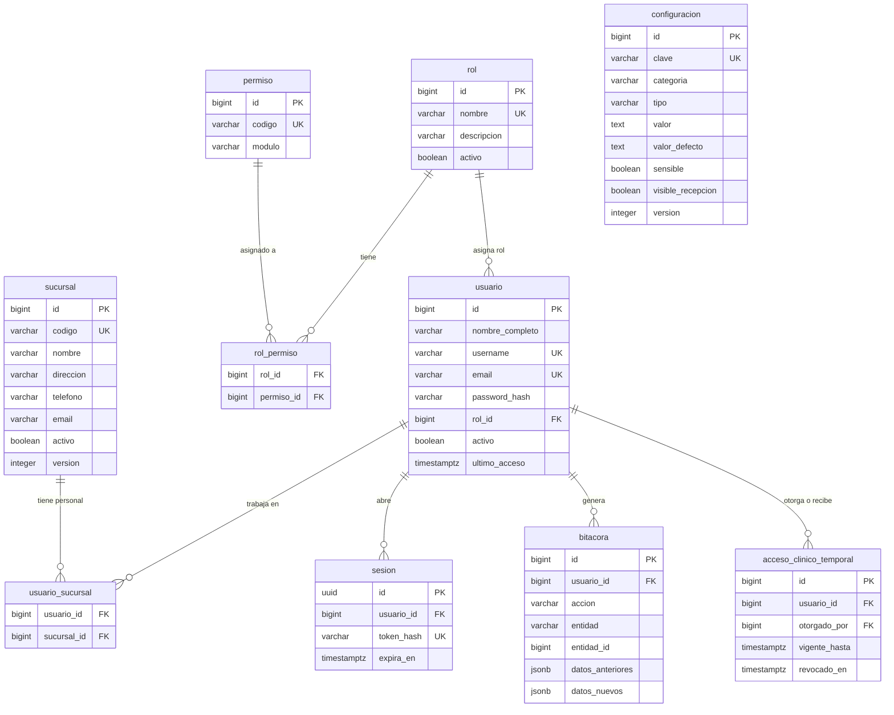
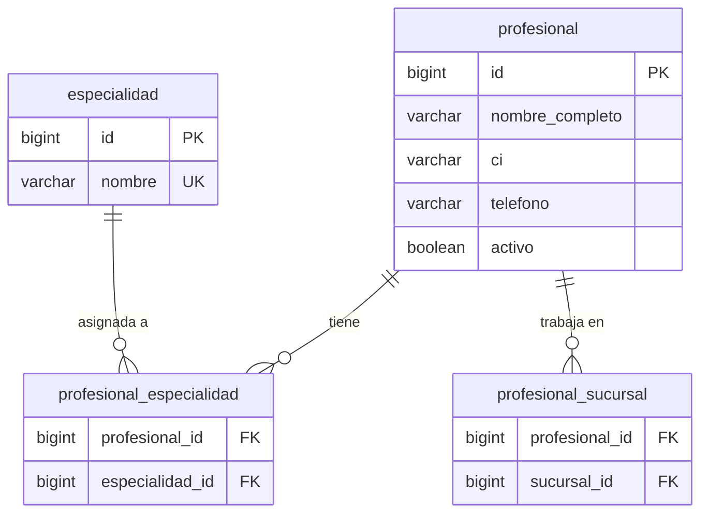
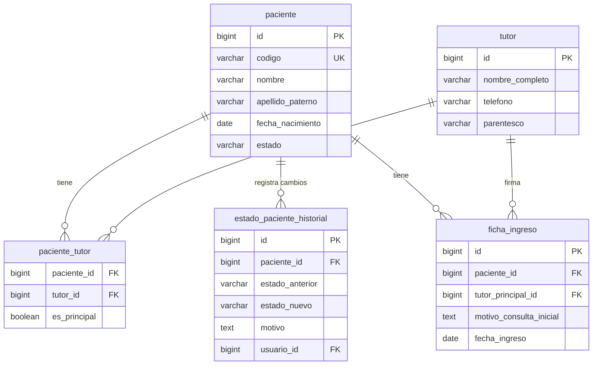
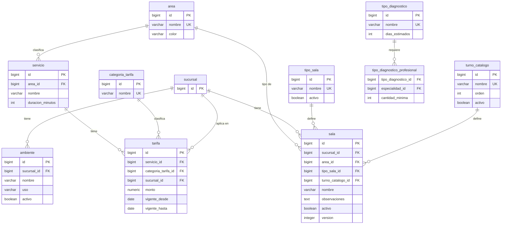
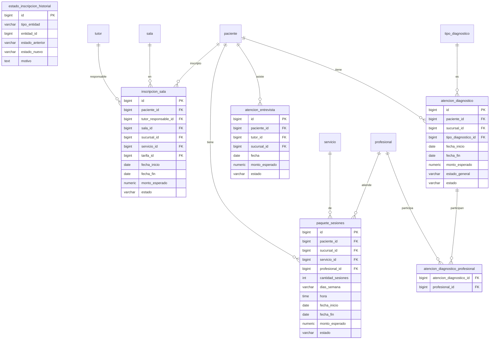
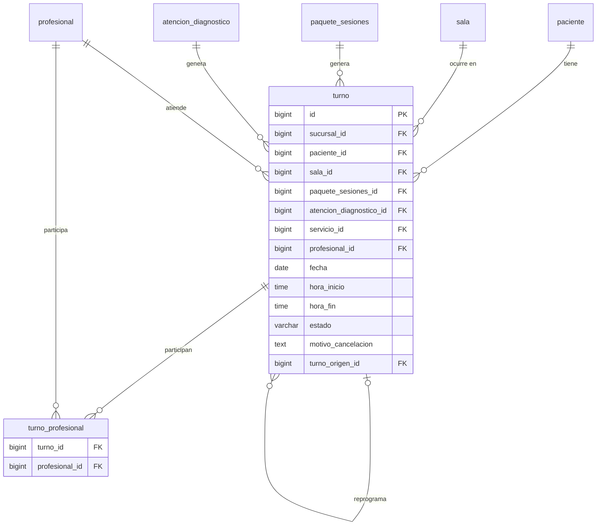
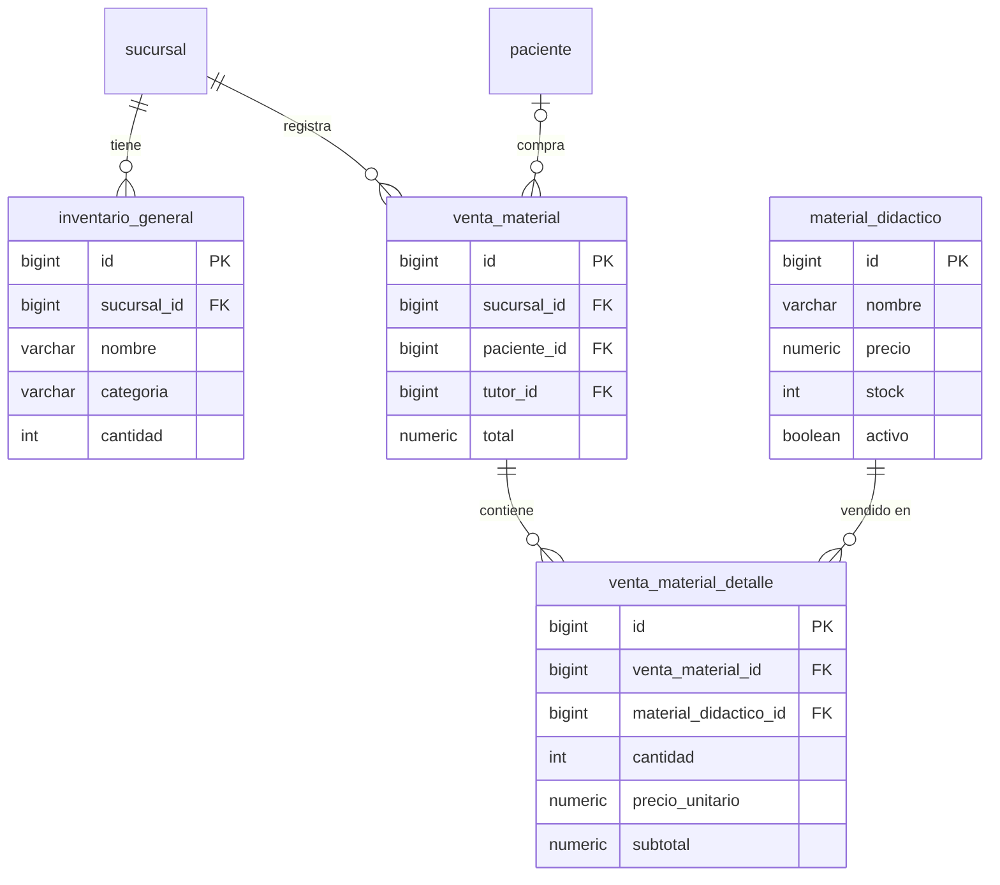
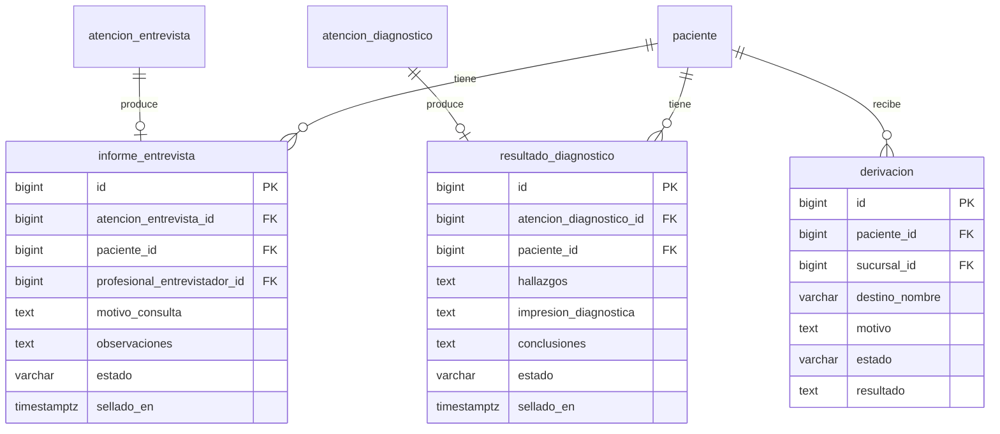
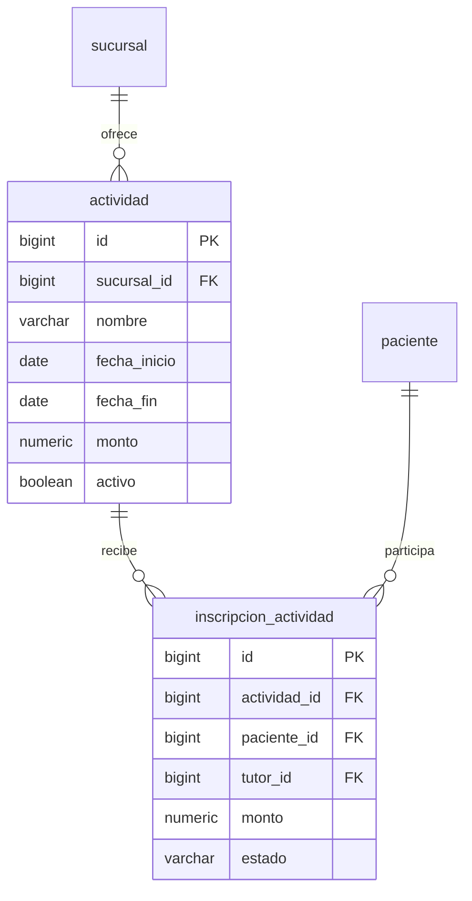

# Base de datos — Sistema de Gestión TalitaCumi

Referencia del esquema PostgreSQL del sistema. Las migraciones deben coincidir con este documento: si cambias una, actualiza el otro en el mismo cambio.

---

## Principios

- **Los documentos no se borran ni se editan.** Pagos, inscripciones, turnos, atenciones, ventas, cajas, cuotas y derivaciones se **anulan** con estado, fecha, usuario y motivo. El inventario se corrige con movimientos inversos.
- **Lo que la BD puede garantizar, lo garantiza** con FKs, CHECKs, índices únicos parciales y triggers. La aplicación valida antes solo para dar mensajes claros.
- **Multisucursal en una sola BD.** Pacientes, tutores, profesionales, servicios, tarifas base y catálogos son globales. Lo transaccional lleva `sucursal_id`.
- **Snapshots.** Cada línea de pago, turno, inscripción y venta copia el monto, el nombre y la tarifa del momento. Cambiar una tarifa no altera documentos pasados.
- **Los cambios de estado quedan en bitácora.** Toda transición de estado de paciente, inscripción, paquete, turno, pago y clínico se registra con usuario, fecha y motivo.
- **El contenido clínico es sensible.** Se cifra en reposo y en tránsito, se accede por rol y sucursal, y cada consulta queda en bitácora.

---

## Convenciones

| Tema | Convención |
|---|---|
| Nombres | Tablas y columnas en español, `snake_case`, tablas en plural. |
| Claves | `bigint identity` (`GENERATED ALWAYS AS IDENTITY`). |
| Dinero | `numeric(12,2)` en bolivianos. Costos unitarios `numeric(14,4)`. Nunca `float`. |
| Tiempo | `timestamptz` guardado en UTC y mostrado en `America/La_Paz`. `date` para valores sin hora (vencimientos, fechas de inicio y fin). |
| Estados | `varchar` + `CHECK (... IN (...))`, mapeado a enums PHP. No usar el tipo ENUM de Postgres. |
| FKs | Siempre con índice explícito (Postgres no los crea). `ON DELETE RESTRICT` en todo lo transaccional. |
| Borrado | **Soft delete solo en maestros**: `paciente`, `tutor`, `profesional`, `servicio`, `material_didactico`. Todo lo demás se anula con estado. |
| Nulos | Columnas `NOT NULL` salvo las marcadas como NULL en el diccionario. |
| Búsqueda | Extensión `pg_trgm` con índices GIN en nombres de paciente, tutor, profesional, servicio y material. |
| SQL crudo | CHECKs complejos, índices parciales, `UNIQUE NULLS NOT DISTINCT` y triggers van en las migraciones con `DB::statement`. |
| Correlativos | `numero_correlativo` por sucursal y tipo, tomado de `secuencia_pago` con `SELECT … FOR UPDATE` (o `INSERT … ON CONFLICT DO UPDATE`) dentro de la transacción del documento. |
| Auditoría | Trigger `fn_auditar_cambio()` en tablas críticas. Los eventos se registran con `SET LOCAL app.usuario_id`.

Papel de cada tabla: **Maestro** (datos que se editan) · **Configuración** (listas cortas) · **Documento** (se anula, no se borra) · **Detalle** (líneas de un documento) · **Caché derivada** (recalculable) · **Pivot** · **Historial** (solo inserción).

---

## Diagramas por módulo

No se dibujan las relaciones con `sucursal` ni con `usuario` en todas las tablas para no saturar los diagramas: toda tabla con `sucursal_id` pertenece a una sucursal, y `usuario_registro_id`, `usuario_id` y `*_por` apuntan a `usuario`.

### Identidad, sucursales y seguridad

### Profesionales

### Pacientes y tutores

### Catálogo de servicios, tarifas, salas y ambientes

### Inscripciones y atenciones

### Agenda y turnos

### Pagos, caja y cuotas

```mermaid
erDiagram
    pago {
        bigint id PK
        varchar numero_correlativo UK
        bigint sucursal_id FK
        bigint paciente_id FK
        bigint tutor_id FK
        bigint inscripcion_sala_id FK
        bigint paquete_sesiones_id FK
        bigint atencion_entrevista_id FK
        bigint atencion_diagnostico_id FK
        bigint venta_material_id FK
        numeric monto
        varchar medio_pago
        date fecha_pago
        varchar estado
        text motivo_anulacion
    }
    caja {
        bigint id PK
        bigint sucursal_id FK
        date fecha
        numeric monto_inicial
        numeric monto_contado
        numeric diferencia
        varchar estado
    }
    caja_gasto {
        bigint id PK
        bigint caja_id FK
        varchar motivo
        numeric monto
    }
    plan_cuotas {
        bigint id PK
        varchar tipo_entidad
        bigint entidad_id
        numeric monto_total
        varchar estado
    }
    cuota {
        bigint id PK
        bigint plan_cuotas_id FK
        int numero
        numeric monto
        date fecha_vencimiento
        varchar estado
    }
    cuota_pago {
        bigint cuota_id FK
        bigint pago_id FK
    }
    secuencia_pago {
        bigint sucursal_id PK
        int ultimo_numero
    }

    paciente ||--o{ pago : "paga"
    tutor ||--o{ pago : "abona"
    sucursal ||--o{ pago : "registra"
    inscripcion_sala |o--o{ pago : "cancela"
    paquete_sesiones |o--o{ pago : "cancela"
    atencion_entrevista |o--o{ pago : "cancela"
    atencion_diagnostico |o--o{ pago : "cancela"
    venta_material |o--o{ pago : "cancela"
    sucursal ||--o{ caja : "abre"
    caja ||--o{ caja_gasto : "registra"
    plan_cuotas ||--o{ cuota : "contiene"
    cuota ||--o{ cuota_pago : "pagada con"
    pago ||--o{ cuota_pago : "aplica a"
```

### Inventario y ventas (preliminar)

### Evaluaciones y resultados (clínico)

### Actividades extras (preliminar)

---

## Diccionario

### Identidad, sucursales y seguridad

#### `sucursal` — Sucursales

*Configuración.* Las sucursales del centro. Todo lo transaccional lleva `sucursal_id`. Cada usuario accede a una o varias.

| Columna | Tipo | Null | Restricciones | Nota |
|---|---|---|---|---|
| `id` | `bigint` |  | `PK identity` |  |
| `codigo` | `varchar(50)` |  | `UNIQUE` funcional | Único sin distinguir mayúsculas ni espacios externos |
| `nombre` | `varchar(150)` |  | `UNIQUE` funcional | Único sin distinguir mayúsculas ni espacios externos |
| `direccion` | `text` | sí |  |  |
| `telefono` | `varchar(30)` | sí |  |  |
| `email` | `varchar(150)` | sí |  |  |
| `activo` | `boolean` |  | `DEFAULT true` | Estado vigente: activa/inactiva |
| `version` | `integer` |  | `DEFAULT 1` | Concurrencia optimista |

Índices: `UNIQUE ((lower(trim(codigo))))`, `UNIQUE ((lower(trim(nombre))))`. Los espacios internos se normalizan en la aplicación antes de guardar.

Timestamps: `created_at`, `updated_at`.

#### `rol` — Roles

*Configuración.* Roles base: Superadmin, Administración, Recepción. Los permisos son fijos (definidos por el sistema), pero el rol es editable en su descripción.

| Columna | Tipo | Null | Restricciones | Nota |
|---|---|---|---|---|
| `id` | `bigint` |  | `PK identity` |  |
| `nombre` | `varchar(50)` |  | `UK` |  |
| `descripcion` | `text` | sí |  |  |
| `activo` | `boolean` |  | `DEFAULT true` |  |

Timestamps: `created_at`, `updated_at`.

#### `permiso` — Permisos

*Configuración.* Permisos granulares por módulo y acción, definidos por el sistema. `codigo` es único (`paciente.ver`, `pago.anular`, `clinico.exportar`…).

| Columna | Tipo | Null | Restricciones | Nota |
|---|---|---|---|---|
| `id` | `bigint` |  | `PK identity` |  |
| `codigo` | `varchar(100)` |  | `UK` |  |
| `descripcion` | `text` | sí |  |  |
| `modulo` | `varchar(50)` |  |  |  |

Timestamps: solo `created_at`.

#### `rol_permiso` — Permisos por rol

*Pivot.*

| Columna | Tipo | Null | Restricciones | Nota |
|---|---|---|---|---|
| `rol_id` | `bigint` |  | `FK → rol` |  |
| `permiso_id` | `bigint` |  | `FK → permiso` |  |

`PRIMARY KEY (rol_id, permiso_id)`. Sin timestamps.

#### `usuario` — Usuarios

*Maestro.* Solo Superadmin, Administración y Recepción usan el sistema. Los profesionales y los padres no.

| Columna | Tipo | Null | Restricciones | Nota |
|---|---|---|---|---|
| `id` | `bigint` |  | `PK identity` |  |
| `nombre_completo` | `varchar(200)` |  |  |  |
| `email` | `varchar(150)` |  | `UK` |  |
| `username` | `varchar(100)` |  | `UK` |  |
| `password_hash` | `varchar(255)` |  |  | bcrypt o Argon2 |
| `rol_id` | `bigint` |  | `FK → rol` |  |
| `activo` | `boolean` |  | `DEFAULT true` |  |
| `ultimo_acceso` | `timestamptz` | sí |  |  |
| `intentos_fallidos` | `int` |  | `DEFAULT 0` |  |
| `bloqueado_hasta` | `timestamptz` | sí |  |  |

Índices: `UNIQUE (email)`, `UNIQUE (username)`, `INDEX (rol_id)`. Timestamps: `created_at`, `updated_at`.

#### `usuario_sucursal` — Usuario en sucursal

*Pivot.* En qué sucursales puede trabajar cada usuario. La sucursal activa se guarda en sesión y se revalida en cada petición.

| Columna | Tipo | Null | Restricciones | Nota |
|---|---|---|---|---|
| `usuario_id` | `bigint` |  | `FK → usuario` |  |
| `sucursal_id` | `bigint` |  | `FK → sucursal` |  |

`PRIMARY KEY (usuario_id, sucursal_id)`, `INDEX (sucursal_id)`. Sin timestamps.

#### `sesion` — Sesiones

*Documento.* Sesiones activas. Token con hash. Cierre por inactividad en contenido clínico.

| Columna | Tipo | Null | Restricciones | Nota |
|---|---|---|---|---|
| `id` | `uuid` |  | `PK` |  |
| `usuario_id` | `bigint` |  | `FK → usuario` |  |
| `token_hash` | `varchar(255)` |  | `UK` |  |
| `ip` | `varchar(45)` | sí |  |  |
| `user_agent` | `text` | sí |  |  |
| `creada_en` | `timestamptz` |  | `DEFAULT now()` |  |
| `expira_en` | `timestamptz` |  |  |  |
| `cerrada_en` | `timestamptz` | sí |  |  |

Índices: `INDEX (usuario_id)`, `INDEX (expira_en)`.

#### `bitacora` — Bitácora

*Historial.* Solo inserción. Registra quién hizo qué, cuándo y en qué sucursal. Inmutable.

| Columna | Tipo | Null | Restricciones | Nota |
|---|---|---|---|---|
| `id` | `bigint` |  | `PK identity` |  |
| `usuario_id` | `bigint` | sí | `FK → usuario` | NULL en intentos fallidos |
| `sucursal_id` | `bigint` | sí | `FK → sucursal` |  |
| `accion` | `varchar(100)` |  |  | `INSERT`, `UPDATE`, `DELETE`, `LOGIN`, `ANULAR`, etc. |
| `entidad` | `varchar(100)` | sí |  | Nombre de la tabla |
| `entidad_id` | `bigint` | sí |  |  |
| `datos_anteriores` | `jsonb` | sí |  |  |
| `datos_nuevos` | `jsonb` | sí |  |  |
| `motivo` | `text` | sí |  | Para anulaciones |
| `ip` | `varchar(45)` | sí |  |  |
| `created_at` | `timestamptz` |  | `DEFAULT now()` |  |

Índices: `(usuario_id)`, `(created_at)`, `(entidad, entidad_id)`, `(accion)`. Trigger `BEFORE UPDATE OR DELETE` que lanza error. Sin `updated_at`.

> **Implementación actual (módulo 01):** mientras el módulo 02 no cree la tabla `usuario`, la migración de `bitacora` referencia `users.id` (tabla real de autenticación de Laravel). Al implementar el módulo 02 se migrará la FK a `usuario`.

#### `acceso_clinico_temporal` — Acceso especial a contenido clínico

*Documento.* Acceso temporal otorgado por Superadmin a un usuario específico, con motivo y vencimiento. Revocable.

| Columna | Tipo | Null | Restricciones | Nota |
|---|---|---|---|---|
| `id` | `bigint` |  | `PK identity` |  |
| `usuario_id` | `bigint` |  | `FK → usuario` |  |
| `otorgado_por` | `bigint` |  | `FK → usuario` |  |
| `recurso` | `varchar(100)` |  |  |  |
| `motivo` | `text` |  |  | Obligatorio |
| `vigente_desde` | `timestamptz` |  | `DEFAULT now()` |  |
| `vigente_hasta` | `timestamptz` |  |  |  |
| `revocado_en` | `timestamptz` | sí |  |  |

Índices: `(usuario_id)`, `(vigente_hasta)`.

#### `configuracion` — Parámetros del sistema

*Configuración.* Valores configurables sin tocar código. Catálogo versionado por seeder/migración; no se crean ni eliminan desde la UI y no tiene borrado lógico.

| Columna | Tipo | Null | Restricciones | Nota |
|---|---|---|---|---|
| `id` | `bigint` |  | `PK identity` |  |
| `clave` | `varchar(100)` |  | `UK` | Clave estable del catálogo (`duracion_sesion_minutos`, `agenda.turno_manana.inicio`, `moneda`…) |
| `categoria` | `varchar(50)` |  | índice | `identidad`, `operacion`, `agenda`, `pagos`, `formato_documentos`, `zona_horaria`, `moneda` |
| `descripcion` | `text` | sí |  | Texto en español para la UI |
| `tipo` | `varchar(20)` |  | `DEFAULT 'texto'`, CHECK | `entero`, `decimal`, `hora`, `texto`, `booleano` |
| `valor` | `text` |  |  | Valor vigente serializado como texto |
| `valor_defecto` | `text` |  |  | Se usa para restaurar (RF-005) |
| `unidad` | `varchar(30)` | sí |  | `minutos`, `horas`, `días`, `Bs`… |
| `minimo` | `text` | sí |  | Límite inferior; en textos representa longitud |
| `maximo` | `text` | sí |  | Límite superior; en textos representa longitud |
| `sensible` | `boolean` |  | `DEFAULT false` | Exige confirmación y motivo (RF-016) |
| `editable` | `boolean` |  | `DEFAULT true` | `false` para moneda, leyenda y logo (carga especial) |
| `visible_recepcion` | `boolean` |  | `DEFAULT false` | Filtra lo que ve Recepción (RF-014) |
| `version` | `integer` |  | `DEFAULT 1` | Concurrencia optimista (409) |

Timestamps: solo `updated_at`. Las altas y cambios se reconstruyen desde `bitacora` (`entidad = 'parametro'`). No hay `sucursal_id`: los parámetros son globales (RN-009).

Índices: `clave` único, `categoria`, `visible_recepcion`. El catálogo inicial tiene 23 claves y se carga con `OrganizacionConfiguracionCatalogSeeder`; cada alta deja un registro `CREAR` en bitácora.

---

### Profesionales

#### `especialidad` — Especialidades

*Configuración.* Catálogo de especialidades (psicología, fonoaudiología, fisioterapia…).

| Columna | Tipo | Null | Restricciones | Nota |
|---|---|---|---|---|
| `id` | `bigint` |  | `PK identity` |  |
| `nombre` | `varchar(100)` |  | `UK` |  |
| `descripcion` | `text` | sí |  |  |
| `activo` | `boolean` |  | `DEFAULT true` |  |

Timestamps: `created_at`, `updated_at`.

#### `profesional` — Profesionales

*Maestro.* Los profesionales NO usan el sistema; son un directorio administrativo.

| Columna | Tipo | Null | Restricciones | Nota |
|---|---|---|---|---|
| `id` | `bigint` |  | `PK identity` |  |
| `nombre_completo` | `varchar(200)` |  |  |  |
| `ci` | `varchar(20)` | sí |  |  |
| `telefono` | `varchar(30)` | sí |  |  |
| `email` | `varchar(150)` | sí |  |  |
| `activo` | `boolean` |  | `DEFAULT true` |  |

Timestamps: `created_at`, `updated_at`. Soft delete: `deleted_at`.

#### `profesional_especialidad` — Especialidades del profesional

*Pivot.* Un profesional puede tener una o más especialidades.

`PRIMARY KEY (profesional_id, especialidad_id)`. Sin timestamps.

#### `profesional_sucursal` — Sucursales del profesional

*Pivot.* En qué sucursales trabaja cada profesional.

`PRIMARY KEY (profesional_id, sucursal_id)`. Sin timestamps.

---

### Pacientes y tutores

#### `paciente` — Pacientes (niños)

*Maestro.* Paciente global (no por sucursal). Estado: activo, en pausa, retirado.

| Columna | Tipo | Null | Restricciones | Nota |
|---|---|---|---|---|
| `id` | `bigint` |  | `PK identity` |  |
| `codigo` | `varchar(30)` |  | `UK` | Autogenerado |
| `nombre` | `varchar(100)` |  |  |  |
| `apellido_paterno` | `varchar(100)` |  |  |  |
| `apellido_materno` | `varchar(100)` | sí |  |  |
| `fecha_nacimiento` | `date` |  |  |  |
| `sexo` | `char(1)` | sí | `CHECK IN ('M','F')` |  |
| `ci` | `varchar(20)` | sí |  |  |
| `estado` | `varchar(20)` |  | `DEFAULT 'activo'`, `CHECK IN ('activo','en_pausa','retirado')` |  |
| `observaciones` | `text` | sí |  |  |

Índices: `(estado)`, `(apellido_paterno, apellido_materno)`, `(ci)`, GIN `(nombre || ' ' || apellido_paterno)` con `pg_trgm`. Timestamps: `created_at`, `updated_at`. Soft delete: `deleted_at`.

#### `tutor` — Tutores

*Maestro.* Tutor del paciente. Teléfono obligatorio para alertas de WhatsApp.

| Columna | Tipo | Null | Restricciones | Nota |
|---|---|---|---|---|
| `id` | `bigint` |  | `PK identity` |  |
| `nombre_completo` | `varchar(200)` |  |  |  |
| `ci` | `varchar(20)` | sí |  |  |
| `telefono` | `varchar(30)` |  |  |  |
| `telefono_alternativo` | `varchar(30)` | sí |  |  |
| `email` | `varchar(150)` | sí |  |  |
| `direccion` | `text` | sí |  |  |
| `parentesco` | `varchar(50)` | sí |  |  |

Índices: `(telefono)`. Timestamps: `created_at`, `updated_at`. Soft delete: `deleted_at`.

#### `paciente_tutor` — Paciente y tutores

*Pivot.* Un paciente puede tener varios tutores. Exactamente uno debe ser principal (lógica de aplicación).

`PRIMARY KEY (paciente_id, tutor_id)`. `es_principal boolean DEFAULT false`. Sin timestamps.

#### `estado_paciente_historial` — Historial del estado del paciente

*Historial.* Solo inserción. Registra las transiciones de estado con motivo.

| Columna | Tipo | Null | Restricciones | Nota |
|---|---|---|---|---|
| `id` | `bigint` |  | `PK identity` |  |
| `paciente_id` | `bigint` |  | `FK → paciente` |  |
| `estado_anterior` | `varchar(20)` | sí |  | NULL en el alta |
| `estado_nuevo` | `varchar(20)` |  | `CHECK IN ('activo','en_pausa','retirado')` |  |
| `motivo` | `text` | sí |  | Obligatorio en pausa/retiro |
| `usuario_id` | `bigint` |  | `FK → usuario` |  |
| `created_at` | `timestamptz` |  | `DEFAULT now()` |  |

Sin `updated_at`.

#### `ficha_ingreso` — Ficha de ingreso

*Documento.* Datos administrativos de ingreso del paciente (no clínicos).

| Columna | Tipo | Null | Restricciones | Nota |
|---|---|---|---|---|
| `id` | `bigint` |  | `PK identity` |  |
| `paciente_id` | `bigint` |  | `FK → paciente` |  |
| `tutor_principal_id` | `bigint` |  | `FK → tutor` |  |
| `motivo_consulta_inicial` | `text` | sí |  |  |
| `derivado_por` | `varchar(200)` | sí |  |  |
| `antecedentes_familiares` | `text` | sí |  |  |
| `observaciones` | `text` | sí |  |  |
| `fecha_ingreso` | `date` |  | `DEFAULT CURRENT_DATE` |  |
| `usuario_registro_id` | `bigint` |  | `FK → usuario` |  |

Timestamps: `created_at`, `updated_at`.

---

### Catálogo

#### `area` — Áreas

*Configuración.* Salas Grupales e Intervención Terapéutica. El color es configurable.

> **Implementación actual:** el submódulo 01.02 crea esta tabla como prerequisito de solo lectura para `sala.area_id`. El CRUD y la administración de colores pertenecen al módulo 05; aquí no se modifican.

| Columna | Tipo | Null | Restricciones | Nota |
|---|---|---|---|---|
| `id` | `bigint` |  | `PK identity` |  |
| `nombre` | `varchar(100)` |  | `UK` |  |
| `color` | `varchar(7)` |  | `DEFAULT '#6B7280'` | Hex, para la agenda |
| `activo` | `boolean` |  | `DEFAULT true` |  |

Timestamps: `created_at`, `updated_at`.

#### `tipo_sala` — Tipos de sala

*Configuración.* Catálogo global administrable (RF-001/RF-002). Los tipos iniciales son preescolar, atención temprana, estimulación temprana y escolar.

| Columna | Tipo | Null | Restricciones | Nota |
|---|---|---|---|---|
| `id` | `bigint` |  | `PK identity` |  |
| `nombre` | `varchar(100)` |  | `UNIQUE` funcional | Único sin distinguir mayúsculas ni espacios externos |
| `activo` | `boolean` |  | `DEFAULT true` |  |
| `version` | `integer` |  | `DEFAULT 1` | Concurrencia optimista |

Índices: `UNIQUE ((lower(trim(nombre))))`. Timestamps: `created_at`, `updated_at`.

#### `turno_catalogo` — Turnos operativos

*Configuración.* Catálogo global administrable (RF-003). No confundir con la tabla `turno` de agenda del módulo 07.

| Columna | Tipo | Null | Restricciones | Nota |
|---|---|---|---|---|
| `id` | `bigint` |  | `PK identity` |  |
| `nombre` | `varchar(50)` |  | `UNIQUE` funcional | Inicialmente mañana y tarde |
| `orden` | `integer` |  | `DEFAULT 0` | Orden de visualización |
| `activo` | `boolean` |  | `DEFAULT true` |  |
| `version` | `integer` |  | `DEFAULT 1` | Concurrencia optimista |

Índices: `UNIQUE ((lower(trim(nombre))))`, `(orden)`. Timestamps: `created_at`, `updated_at`.

#### `sala` — Salas grupales

*Maestro.* Sala = tipo de sala + turno + sucursal. Agregable.

| Columna | Tipo | Null | Restricciones | Nota |
|---|---|---|---|---|
| `id` | `bigint` |  | `PK identity` |  |
| `sucursal_id` | `bigint` |  | `FK → sucursal` |  |
| `area_id` | `bigint` |  | `FK → area` | Referencia para el color de agenda |
| `tipo_sala_id` | `bigint` |  | `FK → tipo_sala` |  |
| `turno_catalogo_id` | `bigint` |  | `FK → turno_catalogo` |  |
| `nombre` | `varchar(150)` |  |  | Nombre visible |
| `observaciones` | `text` | sí |  |  |
| `activo` | `boolean` |  | `DEFAULT true` |  |
| `version` | `integer` |  | `DEFAULT 1` | Concurrencia optimista |

Índices: `UNIQUE (sucursal_id, tipo_sala_id, turno_catalogo_id)`, `(tipo_sala_id)`, `(turno_catalogo_id)`. Timestamps: `created_at`, `updated_at`.

#### `ambiente` — Ambientes

*Maestro.* Espacios de atención individual, entrevista y diagnóstico. Pertenece a una sucursal.

| Columna | Tipo | Null | Restricciones | Nota |
|---|---|---|---|---|
| `id` | `bigint` |  | `PK identity` |  |
| `sucursal_id` | `bigint` |  | `FK → sucursal` |  |
| `nombre` | `varchar(150)` |  | `UNIQUE` funcional por sucursal |  |
| `uso` | `varchar` |  | `CHECK IN ('terapia_individual','entrevista','diagnostico','mixto')` |  |
| `observaciones` | `text` | sí |  |  |
| `activo` | `boolean` |  | `DEFAULT true` |  |
| `version` | `integer` |  | `DEFAULT 1` | Concurrencia optimista |

Índices: `UNIQUE (sucursal_id, lower(trim(nombre)))`, `(sucursal_id)`, `(uso)`. Timestamps: `created_at`, `updated_at`.

#### `servicio` — Servicios

*Maestro.* Terapias, entrevista, diagnóstico, sala grupal, venta de materiales.

| Columna | Tipo | Null | Restricciones | Nota |
|---|---|---|---|---|
| `id` | `bigint` |  | `PK identity` |  |
| `area_id` | `bigint` |  | `FK → area` |  |
| `nombre` | `varchar(150)` |  |  |  |
| `descripcion` | `text` | sí |  |  |
| `duracion_minutos` | `int` |  | `DEFAULT 50` |  |
| `activo` | `boolean` |  | `DEFAULT true` |  |

Índices: GIN `(nombre)` con `pg_trgm`. Timestamps: `created_at`, `updated_at`. Soft delete: `deleted_at`.

#### `categoria_tarifa` — Categorías de tarifa

*Configuración.* General, Hermano, Beca. La elige Recepción al inscribir.

| Columna | Tipo | Null | Restricciones | Nota |
|---|---|---|---|---|
| `id` | `bigint` |  | `PK identity` |  |
| `nombre` | `varchar(100)` |  | `UK` |  |
| `descripcion` | `text` | sí |  |  |
| `activo` | `boolean` |  | `DEFAULT true` |  |

Timestamps: `created_at`, `updated_at`.

#### `tarifa` — Tarifas

*Configuración.* Vigencia por fecha. `sucursal_id` NULL = aplica a todas las sucursales.

| Columna | Tipo | Null | Restricciones | Nota |
|---|---|---|---|---|
| `id` | `bigint` |  | `PK identity` |  |
| `servicio_id` | `bigint` |  | `FK → servicio` |  |
| `categoria_tarifa_id` | `bigint` |  | `FK → categoria_tarifa` |  |
| `sucursal_id` | `bigint` | sí | `FK → sucursal` | NULL = todas |
| `monto` | `numeric(12,2)` |  | `CHECK >= 0` |  |
| `vigente_desde` | `date` |  |  |  |
| `vigente_hasta` | `date` | sí | `CHECK >= vigente_desde` |  |
| `activo` | `boolean` |  | `DEFAULT true` |  |

Índices: `(servicio_id, categoria_tarifa_id)`, `(sucursal_id)`. Timestamps: `created_at`, `updated_at`.

#### `tipo_diagnostico` — Tipos de diagnóstico

*Configuración.* Cada tipo define los profesionales requeridos y los días estimados.

| Columna | Tipo | Null | Restricciones | Nota |
|---|---|---|---|---|
| `id` | `bigint` |  | `PK identity` |  |
| `nombre` | `varchar(150)` |  | `UK` |  |
| `descripcion` | `text` | sí |  |  |
| `dias_estimados` | `int` |  | `DEFAULT 1` |  |
| `activo` | `boolean` |  | `DEFAULT true` |  |

Timestamps: `created_at`, `updated_at`.

#### `tipo_diagnostico_profesional` — Profesionales requeridos por tipo

*Configuración.* Define los profesionales mínimos por especialidad para cada tipo de diagnóstico.

`PRIMARY KEY (tipo_diagnostico_id, especialidad_id)`. `cantidad_minima int DEFAULT 1`. Sin timestamps.

---

### Inscripciones y atenciones

#### `inscripcion_sala` — Inscripciones a sala grupal

*Documento.* Inscripción mensual con fecha de inicio y fin.

| Columna | Tipo | Null | Restricciones | Nota |
|---|---|---|---|---|
| `id` | `bigint` |  | `PK identity` |  |
| `paciente_id` | `bigint` |  | `FK → paciente` |  |
| `tutor_responsable_id` | `bigint` |  | `FK → tutor` |  |
| `sala_id` | `bigint` |  | `FK → sala` |  |
| `sucursal_id` | `bigint` |  | `FK → sucursal` |  |
| `servicio_id` | `bigint` |  | `FK → servicio` |  |
| `tarifa_id` | `bigint` |  | `FK → tarifa` |  |
| `categoria_tarifa_id` | `bigint` |  | `FK → categoria_tarifa` |  |
| `fecha_inicio` | `date` |  |  |  |
| `fecha_fin` | `date` |  | `CHECK >= fecha_inicio` |  |
| `monto_esperado` | `numeric(12,2)` |  | `CHECK >= 0` |  |
| `estado` | `varchar(20)` |  | `DEFAULT 'activa'`, `CHECK IN ('activa','en_pausa','vencida','renovada','retirada')` |  |
| `inscripcion_origen_id` | `bigint` | sí | `FK → inscripcion_sala` | Renovación |
| `observaciones` | `text` | sí |  |  |

Índices: `(estado)`, `(fecha_inicio, fecha_fin)`, `(paciente_id)`. Timestamps: `created_at`, `updated_at`.

#### `paquete_sesiones` — Paquetes de sesiones individuales

*Documento.* Paquete de N sesiones con días y hora fijos. 50 min por defecto.

| Columna | Tipo | Null | Restricciones | Nota |
|---|---|---|---|---|
| `id` | `bigint` |  | `PK identity` |  |
| `paciente_id` | `bigint` |  | `FK → paciente` |  |
| `tutor_responsable_id` | `bigint` |  | `FK → tutor` |  |
| `sucursal_id` | `bigint` |  | `FK → sucursal` |  |
| `servicio_id` | `bigint` |  | `FK → servicio` |  |
| `profesional_id` | `bigint` | sí | `FK → profesional` | NULL = sin asignar |
| `tarifa_id` | `bigint` |  | `FK → tarifa` |  |
| `categoria_tarifa_id` | `bigint` |  | `FK → categoria_tarifa` |  |
| `cantidad_sesiones` | `int` |  | `CHECK > 0` |  |
| `dias_semana` | `varchar(50)` |  |  | `"lunes,miercoles,viernes"` |
| `hora` | `time` |  |  |  |
| `duracion_minutos` | `int` |  | `DEFAULT 50` |  |
| `fecha_inicio` | `date` |  |  |  |
| `fecha_fin` | `date` |  | `CHECK >= fecha_inicio` |  |
| `monto_esperado` | `numeric(12,2)` |  | `CHECK >= 0` |  |
| `estado` | `varchar(20)` |  | `DEFAULT 'activo'`, `CHECK IN ('activo','en_pausa','vencido','renovado','retirado')` |  |
| `paquete_origen_id` | `bigint` | sí | `FK → paquete_sesiones` | Renovación |

Índices: `(estado)`, `(fecha_inicio, fecha_fin)`, `(paciente_id)`, `(profesional_id)`. Timestamps: `created_at`, `updated_at`.

#### `atencion_entrevista` — Entrevista con los padres

*Documento.* Atención con costo menor. Una sola entrevista por paciente.

| Columna | Tipo | Null | Restricciones | Nota |
|---|---|---|---|---|
| `id` | `bigint` |  | `PK identity` |  |
| `paciente_id` | `bigint` |  | `FK → paciente` |  |
| `tutor_id` | `bigint` |  | `FK → tutor` |  |
| `sucursal_id` | `bigint` |  | `FK → sucursal` |  |
| `servicio_id` | `bigint` |  | `FK → servicio` |  |
| `tarifa_id` | `bigint` |  | `FK → tarifa` |  |
| `categoria_tarifa_id` | `bigint` |  | `FK → categoria_tarifa` |  |
| `fecha` | `date` |  |  |  |
| `monto_esperado` | `numeric(12,2)` |  |  |  |
| `estado` | `varchar(20)` |  | `DEFAULT 'activa'`, `CHECK IN ('activa','retirada')` |  |
| `notas_admin` | `text` | sí |  |  |

Timestamps: `created_at`, `updated_at`.

#### `atencion_diagnostico` — Diagnóstico o evaluación

*Documento.* Costo mayor, varios días, uno o más profesionales.

| Columna | Tipo | Null | Restricciones | Nota |
|---|---|---|---|---|
| `id` | `bigint` |  | `PK identity` |  |
| `paciente_id` | `bigint` |  | `FK → paciente` |  |
| `sucursal_id` | `bigint` |  | `FK → sucursal` |  |
| `servicio_id` | `bigint` |  | `FK → servicio` |  |
| `tipo_diagnostico_id` | `bigint` |  | `FK → tipo_diagnostico` |  |
| `tarifa_id` | `bigint` |  | `FK → tarifa` |  |
| `categoria_tarifa_id` | `bigint` |  | `FK → categoria_tarifa` |  |
| `fecha_inicio` | `date` |  |  |  |
| `fecha_fin` | `date` |  | `CHECK >= fecha_inicio` |  |
| `monto_esperado` | `numeric(12,2)` |  |  |  |
| `entrevista_previa_id` | `bigint` | sí | `FK → atencion_entrevista` |  |
| `omitio_entrevista` | `boolean` |  | `DEFAULT false` |  |
| `estado_general` | `varchar(20)` |  | `DEFAULT 'incompleto'`, `CHECK IN ('incompleto','en_proceso','completo','cancelado')` |  |
| `estado` | `varchar(20)` |  | `DEFAULT 'activa'`, `CHECK IN ('activa','retirada')` |  |
| `notas_admin` | `text` | sí |  |  |

Timestamps: `created_at`, `updated_at`.

#### `atencion_diagnostico_profesional` — Profesionales del diagnóstico

*Pivot.* Profesionales asignados al diagnóstico.

`PRIMARY KEY (atencion_diagnostico_id, profesional_id)`. Sin timestamps.

#### `estado_inscripcion_historial` — Historial del estado de inscripción/paquete

*Historial.* Registra las transiciones con motivo y usuario.

| Columna | Tipo | Null | Restricciones | Nota |
|---|---|---|---|---|
| `id` | `bigint` |  | `PK identity` |  |
| `tipo_entidad` | `varchar(30)` |  | `CHECK IN ('inscripcion_sala','paquete_sesiones')` |  |
| `entidad_id` | `bigint` |  |  |  |
| `estado_anterior` | `varchar(20)` | sí |  |  |
| `estado_nuevo` | `varchar(20)` |  |  |  |
| `motivo` | `text` | sí |  |  |
| `usuario_id` | `bigint` |  | `FK → usuario` |  |
| `created_at` | `timestamptz` |  | `DEFAULT now()` |  |

Sin `updated_at`.

---

### Agenda y turnos

#### `turno` — Turnos

*Documento.* Un turno es de sala, paquete o diagnóstico (exactamente uno). Se puede reprogramar o cancelar.

| Columna | Tipo | Null | Restricciones | Nota |
|---|---|---|---|---|
| `id` | `bigint` |  | `PK identity` |  |
| `sucursal_id` | `bigint` |  | `FK → sucursal` |  |
| `paciente_id` | `bigint` |  | `FK → paciente` |  |
| `sala_id` | `bigint` | sí | `FK → sala` |  |
| `paquete_sesiones_id` | `bigint` | sí | `FK → paquete_sesiones` |  |
| `atencion_diagnostico_id` | `bigint` | sí | `FK → atencion_diagnostico` |  |
| `servicio_id` | `bigint` |  | `FK → servicio` |  |
| `profesional_id` | `bigint` | sí | `FK → profesional` | NULL = sin asignar |
| `fecha` | `date` |  |  |  |
| `hora_inicio` | `time` |  |  |  |
| `hora_fin` | `time` |  | `CHECK > hora_inicio` |  |
| `duracion_minutos` | `int` |  | `DEFAULT 50` |  |
| `estado` | `varchar(20)` |  | `DEFAULT 'programado'`, `CHECK IN ('programado','asistio','falto','cancelado','reprogramado')` |  |
| `motivo_cancelacion` | `text` | sí |  |  |
| `turno_origen_id` | `bigint` | sí | `FK → turno` |  |
| `usuario_registro_id` | `bigint` | sí | `FK → usuario` |  |
| `usuario_asistencia_id` | `bigint` | sí | `FK → usuario` |  |
| `asistencia_registrada_en` | `timestamptz` | sí |  |  |

Índices: `(fecha)`, `(sucursal_id, fecha)`, `(paciente_id)`, `(profesional_id)`, `(estado)`, `(sala_id, fecha)`. CHECK: exactamente uno de `sala_id`, `paquete_sesiones_id` o `atencion_diagnostico_id` no nulo. Timestamps: `created_at`, `updated_at`.

> **TODO módulo 07:** la tabla actual solo referencia `sala_id`. Para las terapias individuales, entrevistas y diagnósticos se evaluará agregar `ambiente_id` y consumir `AmbienteDirectoryContract`. No se modificó esta tabla en el submódulo 01.02.

#### `turno_profesional` — Profesionales por turno

*Pivot.* Para diagnósticos con varios profesionales en el mismo turno.

`PRIMARY KEY (turno_id, profesional_id)`. Sin timestamps.

---

### Pagos y caja

#### `pago` — Pagos

*Documento.* Cada pago se vincula a exactamente una entidad. Número correlativo por sucursal. No se borra: se anula con motivo.

| Columna | Tipo | Null | Restricciones | Nota |
|---|---|---|---|---|
| `id` | `bigint` |  | `PK identity` |  |
| `numero_correlativo` | `varchar(30)` |  | `UNIQUE (sucursal_id, numero_correlativo)` | Autogenerado |
| `sucursal_id` | `bigint` |  | `FK → sucursal` |  |
| `paciente_id` | `bigint` |  | `FK → paciente` |  |
| `tutor_id` | `bigint` |  | `FK → tutor` |  |
| `inscripcion_sala_id` | `bigint` | sí | `FK → inscripcion_sala` |  |
| `paquete_sesiones_id` | `bigint` | sí | `FK → paquete_sesiones` |  |
| `atencion_entrevista_id` | `bigint` | sí | `FK → atencion_entrevista` |  |
| `atencion_diagnostico_id` | `bigint` | sí | `FK → atencion_diagnostico` |  |
| `venta_material_id` | `bigint` | sí | `FK → venta_material` |  |
| `monto` | `numeric(12,2)` |  | `CHECK > 0` |  |
| `medio_pago` | `varchar(20)` |  | `CHECK IN ('efectivo','qr')` |  |
| `fecha_pago` | `date` |  | `DEFAULT CURRENT_DATE` |  |
| `estado` | `varchar(20)` |  | `DEFAULT 'vigente'`, `CHECK IN ('vigente','anulado')` |  |
| `anulado_en` | `timestamptz` | sí |  |  |
| `anulado_por` | `bigint` | sí | `FK → usuario` |  |
| `motivo_anulacion` | `text` | sí |  |  |
| `usuario_registro_id` | `bigint` |  | `FK → usuario` |  |

Índices: `(fecha_pago)`, `(sucursal_id, fecha_pago)`, `(estado)`, `(inscripcion_sala_id)`, `(paquete_sesiones_id)`. CHECK: exactamente uno de las 5 FKs no nulo. Timestamps: `created_at`, `updated_at`.

#### `secuencia_pago` — Secuencia de pagos por sucursal

*Configuración.* Último número usado por sucursal. Solo la escribe `fn_siguiente_numero_pago`, dentro de la transacción del pago.

`PRIMARY KEY (sucursal_id)`. `ultimo_numero int DEFAULT 0`. Sin timestamps.

#### `caja` — Caja diaria

*Documento.* Una caja abierta por sucursal y día.

| Columna | Tipo | Null | Restricciones | Nota |
|---|---|---|---|---|
| `id` | `bigint` |  | `PK identity` |  |
| `sucursal_id` | `bigint` |  | `FK → sucursal` |  |
| `fecha` | `date` |  | `DEFAULT CURRENT_DATE` |  |
| `monto_inicial` | `numeric(12,2)` |  | `DEFAULT 0` |  |
| `monto_contado` | `numeric(12,2)` | sí |  |  |
| `diferencia` | `numeric(12,2)` | sí |  |  |
| `estado` | `varchar(20)` |  | `DEFAULT 'abierta'`, `CHECK IN ('abierta','cerrada')` |  |
| `abierta_por` | `bigint` |  | `FK → usuario` |  |
| `cerrada_por` | `bigint` | sí | `FK → usuario` |  |
| `abierta_en` | `timestamptz` |  | `DEFAULT now()` |  |
| `cerrada_en` | `timestamptz` | sí |  |  |
| `observaciones` | `text` | sí |  |  |

`UNIQUE (sucursal_id, fecha)`. Timestamps: `created_at`, `updated_at`.

#### `caja_gasto` — Gastos menores de caja

*Detalle.* Gastos del día con motivo, monto y comprobante opcional.

| Columna | Tipo | Null | Restricciones | Nota |
|---|---|---|---|---|
| `id` | `bigint` |  | `PK identity` |  |
| `caja_id` | `bigint` |  | `FK → caja` |  |
| `motivo` | `varchar(200)` |  |  |  |
| `monto` | `numeric(12,2)` |  | `CHECK > 0` |  |
| `comprobante` | `varchar(255)` | sí |  |  |
| `usuario_id` | `bigint` |  | `FK → usuario` |  |
| `created_at` | `timestamptz` |  | `DEFAULT now()` |  |

Sin `updated_at`.

#### `plan_cuotas` — Plan de cuotas

*Documento.* Etapa 2. Plan de cuotas de una inscripción o paquete.

| Columna | Tipo | Null | Restricciones | Nota |
|---|---|---|---|---|
| `id` | `bigint` |  | `PK identity` |  |
| `tipo_entidad` | `varchar(30)` |  | `CHECK IN ('inscripcion_sala','paquete_sesiones')` |  |
| `entidad_id` | `bigint` |  |  |  |
| `monto_total` | `numeric(12,2)` |  | `CHECK > 0` |  |
| `estado` | `varchar(20)` |  | `DEFAULT 'activo'`, `CHECK IN ('activo','completado','anulado')` |  |
| `creado_por` | `bigint` |  | `FK → usuario` |  |

Timestamps: `created_at`, `updated_at`.

#### `cuota` — Cuotas del plan

*Detalle.* Cada cuota con fecha de vencimiento y estado.

| Columna | Tipo | Null | Restricciones | Nota |
|---|---|---|---|---|
| `id` | `bigint` |  | `PK identity` |  |
| `plan_cuotas_id` | `bigint` |  | `FK → plan_cuotas` |  |
| `numero` | `int` |  | `UNIQUE (plan_cuotas_id, numero)` |  |
| `monto` | `numeric(12,2)` |  | `CHECK > 0` |  |
| `fecha_vencimiento` | `date` |  |  |  |
| `estado` | `varchar(20)` |  | `DEFAULT 'pendiente'`, `CHECK IN ('pendiente','pagada','parcial','vencida','anulada')` |  |
| `motivo_anulacion` | `text` | sí |  |  |

Timestamps: `created_at`, `updated_at`.

#### `cuota_pago` — Pago aplicado a cuota

*Pivot.*

`PRIMARY KEY (cuota_id, pago_id)`. Sin timestamps.

---

### Inventario y ventas (preliminar — refinar cuando se documente el módulo 10)

#### `inventario_general` — Inventario general

*Documento.* Conteo de limpieza e inmobiliario. No se vende.

| Columna | Tipo | Null | Restricciones | Nota |
|---|---|---|---|---|
| `id` | `bigint` |  | `PK identity` |  |
| `sucursal_id` | `bigint` |  | `FK → sucursal` |  |
| `nombre` | `varchar(200)` |  |  |  |
| `categoria` | `varchar(50)` |  |  |  |
| `cantidad` | `int` |  | `DEFAULT 0` |  |
| `unidad` | `varchar(20)` | sí |  |  |
| `notas` | `text` | sí |  |  |
| `ultimo_conteo` | `date` | sí |  |  |

Timestamps: `created_at`, `updated_at`.

#### `material_didactico` — Materiales didácticos

*Maestro.* Se venden y descuentan stock.

| Columna | Tipo | Null | Restricciones | Nota |
|---|---|---|---|---|
| `id` | `bigint` |  | `PK identity` |  |
| `nombre` | `varchar(200)` |  |  |  |
| `descripcion` | `text` | sí |  |  |
| `precio` | `numeric(12,2)` |  | `CHECK >= 0` |  |
| `stock` | `int` |  | `DEFAULT 0` |  |
| `activo` | `boolean` |  | `DEFAULT true` |  |

Timestamps: `created_at`, `updated_at`. Soft delete: `deleted_at`.

#### `venta_material` — Ventas de materiales

*Documento.*

| Columna | Tipo | Null | Restricciones | Nota |
|---|---|---|---|---|
| `id` | `bigint` |  | `PK identity` |  |
| `sucursal_id` | `bigint` |  | `FK → sucursal` |  |
| `paciente_id` | `bigint` | sí | `FK → paciente` |  |
| `tutor_id` | `bigint` | sí | `FK → tutor` |  |
| `total` | `numeric(12,2)` |  | `CHECK > 0` |  |
| `usuario_id` | `bigint` |  | `FK → usuario` |  |

Timestamps: `created_at`.

#### `venta_material_detalle` — Líneas de venta

*Detalle.*

| Columna | Tipo | Null | Restricciones | Nota |
|---|---|---|---|---|
| `id` | `bigint` |  | `PK identity` |  |
| `venta_material_id` | `bigint` |  | `FK → venta_material` |  |
| `material_didactico_id` | `bigint` |  | `FK → material_didactico` |  |
| `cantidad` | `int` |  | `CHECK > 0` |  |
| `precio_unitario` | `numeric(12,2)` |  | `CHECK >= 0` |  |
| `subtotal` | `numeric(12,2)` |  | `CHECK > 0` |  |

Sin timestamps.

---

### Evaluaciones y resultados (clínico)

> Contenido sensible. Acceso restringido a Administración y Superadmin. Cifrado en reposo. Cada consulta, edición e impresión queda en bitácora.

#### `informe_entrevista` — Informe de entrevista

*Documento clínico.* Se sella al finalizar; no editable.

| Columna | Tipo | Null | Restricciones | Nota |
|---|---|---|---|---|
| `id` | `bigint` |  | `PK identity` |  |
| `atencion_entrevista_id` | `bigint` |  | `FK → atencion_entrevista`, `UNIQUE` | Una por atención |
| `paciente_id` | `bigint` |  | `FK → paciente` |  |
| `profesional_entrevistador_id` | `bigint` | sí | `FK → profesional` |  |
| `motivo_consulta` | `text` | sí |  |  |
| `antecedentes` | `text` | sí |  |  |
| `observaciones` | `text` | sí |  |  |
| `conclusiones` | `text` | sí |  |  |
| `estado` | `varchar(20)` |  | `DEFAULT 'borrador'`, `CHECK IN ('borrador','final','anulado')` |  |
| `motivo_anulacion` | `text` | sí |  |  |
| `sellado_en` | `timestamptz` | sí |  |  |
| `usuario_registro_id` | `bigint` |  | `FK → usuario` |  |

Timestamps: `created_at`, `updated_at`.

#### `resultado_diagnostico` — Resultado del diagnóstico

*Documento clínico.* Se sella al finalizar; no editable.

| Columna | Tipo | Null | Restricciones | Nota |
|---|---|---|---|---|
| `id` | `bigint` |  | `PK identity` |  |
| `atencion_diagnostico_id` | `bigint` |  | `FK → atencion_diagnostico`, `UNIQUE` | Uno por diagnóstico |
| `paciente_id` | `bigint` |  | `FK → paciente` |  |
| `hallazgos` | `text` | sí |  |  |
| `impresion_diagnostica` | `text` | sí |  |  |
| `conclusiones` | `text` | sí |  |  |
| `recomendaciones` | `text` | sí |  |  |
| `estado` | `varchar(20)` |  | `DEFAULT 'borrador'`, `CHECK IN ('borrador','final','anulado')` |  |
| `motivo_anulacion` | `text` | sí |  |  |
| `sellado_en` | `timestamptz` | sí |  |  |
| `informe_entrevista_id` | `bigint` | sí | `FK → informe_entrevista` |  |
| `usuario_registro_id` | `bigint` |  | `FK → usuario` |  |

Timestamps: `created_at`, `updated_at`.

#### `derivacion` — Derivaciones

*Documento.* Derivación a otro profesional o institución. Vinculada a la atención de origen.

| Columna | Tipo | Null | Restricciones | Nota |
|---|---|---|---|---|
| `id` | `bigint` |  | `PK identity` |  |
| `paciente_id` | `bigint` |  | `FK → paciente` |  |
| `sucursal_id` | `bigint` |  | `FK → sucursal` |  |
| `tipo_atencion_origen` | `varchar(30)` |  | `CHECK IN ('entrevista','diagnostico','terapia')` |  |
| `atencion_origen_id` | `bigint` | sí |  |  |
| `destino_nombre` | `varchar(200)` |  |  |  |
| `destino_especialidad` | `varchar(150)` | sí |  |  |
| `destino_contacto` | `varchar(200)` | sí |  |  |
| `motivo` | `text` |  |  |  |
| `recomendaciones` | `text` | sí |  |  |
| `estado` | `varchar(20)` |  | `DEFAULT 'pendiente'`, `CHECK IN ('pendiente','realizada','no_realizada','sin_respuesta','anulada')` |  |
| `resultado` | `text` | sí |  |  |
| `fecha_derivacion` | `date` |  | `DEFAULT CURRENT_DATE` |  |
| `fecha_resultado` | `date` | sí |  |  |
| `motivo_anulacion` | `text` | sí |  |  |
| `usuario_registro_id` | `bigint` |  | `FK → usuario` |  |

Timestamps: `created_at`, `updated_at`.

---

### Actividades extras (preliminar — refinar cuando se documente el módulo 12)

#### `actividad` — Actividades

*Maestro.* Talleres, eventos y actividades fuera de la oferta habitual.

| Columna | Tipo | Null | Restricciones | Nota |
|---|---|---|---|---|
| `id` | `bigint` |  | `PK identity` |  |
| `sucursal_id` | `bigint` |  | `FK → sucursal` |  |
| `nombre` | `varchar(200)` |  |  |  |
| `descripcion` | `text` | sí |  |  |
| `fecha_inicio` | `date` |  |  |  |
| `fecha_fin` | `date` |  | `CHECK >= fecha_inicio` |  |
| `monto` | `numeric(12,2)` |  | `DEFAULT 0` |  |
| `activo` | `boolean` |  | `DEFAULT true` |  |

Timestamps: `created_at`, `updated_at`.

#### `inscripcion_actividad` — Inscripción a actividad

*Documento.*

| Columna | Tipo | Null | Restricciones | Nota |
|---|---|---|---|---|
| `id` | `bigint` |  | `PK identity` |  |
| `actividad_id` | `bigint` |  | `FK → actividad` |  |
| `paciente_id` | `bigint` |  | `FK → paciente` |  |
| `tutor_id` | `bigint` |  | `FK → tutor` |  |
| `monto` | `numeric(12,2)` |  |  |  |
| `estado` | `varchar(20)` |  | `DEFAULT 'activa'`, `CHECK IN ('activa','retirada')` |  |

Timestamps: `created_at`, `updated_at`.

---

## Reglas de integridad

| Regla | Dónde | Mecanismo |
|---|---|---|
| Un pago se vincula a exactamente una entidad | BD | `CHECK` con suma de `IS NOT NULL` = 1 |
| Un turno es de sala, paquete o diagnóstico (nunca dos) | BD | `CHECK` con suma de `IS NOT NULL` = 1 |
| Una sala no se repite en la misma sucursal por tipo y turno | BD | `UNIQUE (sucursal_id, tipo_sala_id, turno_catalogo_id)` |
| Un ambiente no repite nombre dentro de la sucursal | BD | `UNIQUE (sucursal_id, lower(trim(nombre)))` |
| Una caja abierta por sucursal y día | BD | `UNIQUE (sucursal_id, fecha)` |
| Un solo informe de entrevista por atención | BD | `UNIQUE (atencion_entrevista_id)` |
| Un solo resultado por diagnóstico | BD | `UNIQUE (atencion_diagnostico_id)` |
| Los pagos no se borran ni se editan | BD | `REVOKE UPDATE, DELETE` al rol de la app; solo anulación con motivo |
| La bitácora no se borra ni se edita | BD | Trigger `BEFORE UPDATE OR DELETE` que lanza error |
| El número correlativo de pago no se repite por sucursal | BD | `UNIQUE (sucursal_id, numero_correlativo)` + `fn_siguiente_numero_pago` con `ON CONFLICT` |
| Fechas de inicio y fin coherentes | BD | `CHECK (fecha_fin >= fecha_inicio)` en inscripciones, paquetes, diagnósticos y actividades |
| Turno con hora de fin posterior a la de inicio | BD | `CHECK (hora_fin > hora_inicio)` |
| Solo médicos autorizados ven contenido clínico | Action | Permiso `clinico.ver` verificado en cada consulta |
| El acceso clínico temporal vence solo | BD + Action | `vigente_hasta` + Job programado que revoca |
| Los estados solo pueden ser los definidos | BD | `CHECK (... IN (...))` en cada tabla con estado |
| Las inscripciones retiradas no permiten asistencias | Action | Validación en `RegistrarAsistencia` |
| Un paciente retirado no se inscribe | Action | Validación en `CrearInscripcion` y `CrearPaquete` |
| Las sesiones vencidas no se trasladan | Action | Cálculo de saldo en el nuevo paquete excluye el anterior |
| La tarifa aplicada es la vigente al inicio | Action | `TarifaVigente` verifica `vigente_desde` y `vigente_hasta` |
| Los pagos no superan el saldo pendiente | Action | Validación con `SELECT ... FOR UPDATE` sobre el pago total |
| El número de cuotas debe sumar el saldo | Action | Validación en `CrearPlanCuotas` |
| Un usuario solo accede a sus sucursales | Action | `BranchContext` revalidado en cada petición |
| El comprobante no es factura | Aplicación | Leyenda fija "Este documento no es factura" en cada PDF |
| Los datos clínicos se cifran en reposo | BD | Cifrado a nivel de base de datos y respaldos (recomendado `pgcrypto` o disco cifrado) |
| Los accesos clínicos quedan en bitácora | BD | Trigger `fn_auditar_cambio()` en tablas clínicas + trigger de consulta |